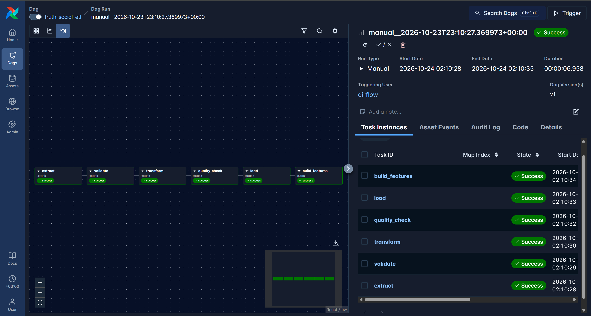
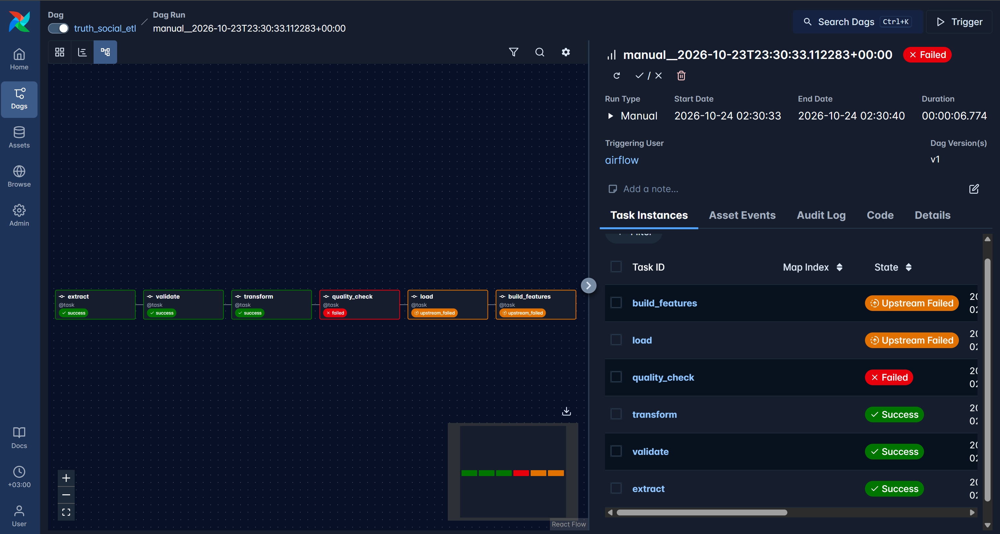

# mlops-labs

Predictive alerts for abnormal S&P 500 moves around Trump's Truth Social posts (AI290 MLOps, KSE).

## Problem

Posts by Donald Trump on Truth Social appear at any time of day and are sometimes followed by sharp moves in the stock market. This project builds a service that, for every new post published during US market hours, estimates the probability that the S&P 500 makes an abnormally large move over the next two hourly bars. A move is abnormal when its absolute log return exceeds 1.5 standard deviations of the same time-slot return over the previous 20 trading days, so the task is binary classification. The service raises an alert for the top 20% of posts by predicted probability, so that an analyst looks at the market sooner. It is a predictive tool only and makes no causal claim that a post causes a market move.

Full design: [docs/design.md](docs/design.md).

## Maturity scorecard

| Property | Evidence a reviewer checks | Added in |
|---|---|---|
| Repository reproducible from a clean clone | CI is green; `make setup` and `make lint` succeed on a fresh clone | Lab 1 |
| Design document exists and is current | `docs/design.md` follows the template, every section filled or marked as an assumption | Lab 1 |
| Data versioned | `data/raw.dvc` (hash `d756bd56a53aee1182a62f609dab15bc.dir`), remote in `.dvc/config`; retrieval command and checksum in [Data](#data) | Lab 2 |
| Pipeline idempotent | `dags/truth_social_etl.py`; row counts after two runs of one month in [ETL pipeline](#etl-pipeline) | Lab 2 |
| Quality gate present | `src/mlops_labs/quality.py`; failed task screenshot [`docs/screenshots/red_airflow.png`](docs/screenshots/red_airflow.png) | Lab 2 |
| Experiments tracked | MLflow experiment `truth-social-abnormal-moves`, [`docs/screenshots/mlflow_runs.png`](docs/screenshots/mlflow_runs.png); results in [Experiments](#experiments) and design 7.2 | Lab 2 |
| Model registered with lineage | model `truth-social-abnormal-move` version 2, alias `champion`, tags `data_version` and `git_commit`: [`mlflow_registry.png`](docs/screenshots/mlflow_registry.png), [`mlflow_version2.png`](docs/screenshots/mlflow_version2.png); `scripts/reproduce.py` | Lab 2 |
| LLM component evaluated | `rag/eval/eval_set.jsonl` (51 questions, relevant post ids, reference answers); hit rate@k, MRR, judged answer score and the quality measures groundedness, hallucination rate, answer relevance, context completeness and utilization per top-k logged as runs in experiment `truth-social-llm-rag`; zero-shot baseline run with `test_pr_auc` in `truth-social-abnormal-moves`; tables in [Lab 3](#lab-3-llm-baseline-and-retrieval) and design 7.2 | Lab 3 |
| Prompts versioned | prompt files in [`rag/prompts/`](rag/prompts); `prompt_hash`, `answer_prompt_hash`, `judge_prompt_hash`, `groundedness_prompt_hash`, `answer_relevance_prompt_hash` and `context_completeness_prompt_hash` are parameters of every LLM run in MLflow | Lab 3 |
| Cost and latency recorded | tokens in and out, cost in USD, p50 and p95 latency per run (51 calls per sweep row, 150 for the zero-shot run); local versus API argued in design 6.3, 6.7 and 7.1 | Lab 3 |
| Retrieval index rebuilt by one command | `python -m rag_lab.ingest` rebuilds corpus → chunks → embeddings → pgvector and prints the document count (3,443); one config `rag/config.yaml` | Lab 3 |

## Setup

```bash
make setup   # uv sync: creates .venv and installs pinned dependencies
make lint    # ruff check
```

Without `make` (e.g. Windows):

```powershell
uv sync
uv run ruff check .
```

## Data

- Posts: [chrissoria/trump-truth-social](https://huggingface.co/datasets/chrissoria/trump-truth-social) on Hugging Face (CC-BY-NC-4.0).
- Prices: hourly `^GSPC` bars from Yahoo Finance via `yfinance`.

`data/raw/` is git-ignored and versioned with DVC.

- **Remote type:** S3-compatible MinIO from the compose stack (`s3://dvc` at `http://localhost:9000`). The remote URL is committed in `.dvc/config`; the credentials are not (they go into `.dvc/config.local`).
- **Retrieval on a clean clone** (stack running, see [Reproduce Lab 2](#reproduce-lab-2)):

```bash
uv run dvc remote modify --local minio access_key_id "<MINIO_ROOT_USER from .env>"
uv run dvc remote modify --local minio secret_access_key "<MINIO_ROOT_PASSWORD from .env>"
uv run dvc pull
```

- **Checksum of what arrives:** directory hash `d756bd56a53aee1182a62f609dab15bc.dir` (2 files, 14,893,864 bytes), files `gspc_1h.csv` md5 `1f25755a2e20c674d4fe07faba6fc9f4` and `train-00000-of-00001.parquet` md5 `695d94551fcdba1f9c2a37090c161ae9`. Checked with a fresh `git clone` followed by `dvc pull`.
- **Size:** 14 MB, so no sampling was needed.

## Reproduce Lab 2

```bash
uv sync
cp .env.example .env            # then set the passwords
docker compose up -d --build    # MinIO, PostgreSQL, MLflow, Airflow
uv run dvc pull                 # credentials as in the Data section
uv run python scripts/trigger_months.py          # 35 monthly DAG runs, one after another
uv run python -m mlops_labs.train --register     # baselines, candidate, registry (commit first)
uv run python scripts/reproduce.py               # rebuild the champion from its tags
uv run python scripts/export_slot_sigma.py      # sigma per slot: parquet into MinIO (Feast offline store)
cd feature_repo && uv sync && uv run python apply.py && uv run python demo.py && cd ..
uv run python scripts/predict.py --check 20      # from the text and time of a post to a score
```

The UIs are at `localhost:8080` (Airflow), `localhost:5000` (MLflow) and `localhost:9001` (MinIO). `make months`, `make train`, `make reproduce`, `make feast-demo` and `make predict-check` run the same steps.

## ETL pipeline

The DAG `truth_social_etl` has seven tasks, chained with `>>`: `extract`, `validate`, `transform`, `quality_check`, `load`, `build_features`, `materialize`. The tasks pass only metadata: each one gets its batch from the run context, reads its input from the warehouse (scratch tables `stg_posts` and `stg_clean`) or from the raw files, writes its output there and returns a few counters as XCom. The batch is one calendar month. It comes from the run's data interval for scheduled runs or from the `month` parameter for manual runs, never from the clock.

**Data interval choice.** The DAG declares the interval explicitly with `schedule=CronDataIntervalTimetable("@monthly", timezone="UTC")` (Airflow 3 would otherwise give `data_interval_start == data_interval_end`). A manual run for one month sets `month` and then ignores the interval.

**Idempotency.** `load` replaces the month with delete-then-insert in one transaction. The same month (`2025-03`) run twice gives identical row counts (warehouse tables, query below):

```text
 run 1, before the rerun            run 2, after the rerun
 raw_posts    638                   raw_posts    638
 clean_posts  138                   clean_posts  138
 features     110                   features     110
```

```sql
SELECT 'raw_posts', count(*) FROM raw_posts WHERE batch='2025-03'
UNION ALL SELECT 'clean_posts', count(*) FROM clean_posts WHERE batch='2025-03'
UNION ALL SELECT 'features', count(*) FROM features WHERE batch='2025-03';
```

All 35 months (2023-12 to 2026-10) were loaded: 35 batches, 3,623 feature rows.

**Quality gate.** `quality_check` runs nine checks between `transform` and `load` (list in design 6.6). It was tested by breaking one month on purpose: `uv run python scripts/make_bad_batch.py 2025-03` copies `data/raw` to `data/raw_bad` and blanks all 638 texts of March 2025, as if the source had started sending only media or reposts; the DAG is then triggered with `{"month": "2025-03", "raw_dir": "/opt/airflow/data/raw_bad"}`. The task fails with `QualityGateError: quality gate failed (1 checks): empty_text_share: 100.0% empty texts, maximum 60%`, `load` and `build_features` do not run, and the warehouse keeps the counts above.

| Successful run | Failed gate |
|---|---|
|  |  |

## Features

`build_features` fills the table `features` (column `feature_version = v1`) from the cleaned rows. Design 5.3 states the serving-time source of every feature.

**Feature store.** Feast (`feature_repo/`, own environment because Feast pins pandas below 3) serves σ per time slot. The offline store is a parquet file in MinIO (`s3://lake/feast/slot_sigma.parquet`, written by `scripts/export_slot_sigma.py`); the registry and the online store are PostgreSQL (database `feast`, created by `feature_repo/apply.py`). `demo.py` shows that a timestamp between two feature rows returns the earlier row, that the store returns exactly the training value for all 3,623 posts (maximum difference 0.0), and that the online store holds the newest row. The last DAG task, `materialize`, refreshes the online store.

## From a post to a score

```bash
uv run python scripts/predict.py --text "Tariffs on China start tomorrow" --time 2025-03-12T15:05:00Z
uv run python scripts/predict.py --post-id <id of an archive post>
uv run python scripts/predict.py --check 20          # serving path == training table?
uv run python scripts/predict.py --post-id <id> --online   # sigma from the online store
```

The post is placed in its hourly bar and slot, σ comes from Feast, the other features are built by the training code (`compute_features`), the champion is loaded from the registry by its alias, and the probability is compared with the alert threshold (top 20% of the validation scores). Posts outside the 09:30 to 14:30 ET window of a trading day, or without text, are not scored and the reason is printed. `--check N` scores N test posts from text and time only and asserts that the result equals the training table.

## Experiments

Time split (design 5.4): train to 2025-06-30, validation 2025-07-01 to 2025-12-31, test from 2026-01-01; 2,266 / 437 / 920 rows. Alert rate 20%, threshold set on validation.

| Model | PR-AUC validation | PR-AUC test | Coverage at 20% alerts, test |
|---|---|---|---|
| B0 constant prior | 0.112 | 0.141 | 0.146 |
| B1 keyword rule | 0.147 | 0.153 | 0.285 |
| B2 context only | 0.208 | 0.185 | 0.162 |
| Candidate (TF-IDF and context, logistic regression) | 0.172 | 0.182 | 0.223 |

**The rule beats the model.** The candidate is not better than the context-only baseline B2 (difference on test -0.003, 95% interval [-0.101, +0.078]), and no model reaches the 40% coverage target. Text adds nothing measurable here. The registry tag `beats_best_baseline_on_val=false` says so; details in design 7.2.

## Registry and reproduction

Every run logs its parameters, metrics and two tags: `data_version` (the DVC hash) and `git_commit`. The candidate is registered as `truth-social-abnormal-move` with the same two tags and the alias `champion` (the name Lab 4 loads by). `train` refuses to register when the data version is unknown, when code has uncommitted changes, or when the warehouse was built from another data version than `data/raw.dvc`.

```bash
uv run python scripts/reproduce.py        # default: models:/truth-social-abnormal-move@champion
```

It reads the two tags of the model version, checks that the code equals the tagged commit (otherwise it prints the `git checkout` to run), restores `data/raw.dvc` from that commit if the data version changed and runs `dvc pull`, trains again from `data/raw` with the same parameters, and compares validation and test PR-AUC with the original run.

**Tolerance: 0.005 absolute PR-AUC.** On the same lock file and seed the reproduced value equals the original (difference 0.00000), also between Linux and Windows after one fix: a first version cut the TF-IDF vocabulary with `max_features`, which tied on 231 terms and broke the ties differently on the two machines (validation PR-AUC 0.162 and 0.173); the vocabulary is now cut by `min_df` only. The tolerance covers last-digit numerical noise of the solver and BLAS; it does not cover a changed data version, vocabulary or library versions, which move the metric by 0.01 or more.

## Lab 3: LLM baseline and retrieval

Two uses of an LLM (design 5.1, 5.3, 5.4): the same abnormal-move label predicted zero-shot (baseline), and a retrieval pipeline over the post archive with its measured market reaction, answered by Claude Haiku.

Everything lives in `rag/` (own `pyproject.toml`, so the Lab 2 lock file and `reproduce.py` are untouched). One config: [`rag/config.yaml`](rag/config.yaml) (chunk size, overlap, embedding model, top-k, LLM, prices). Prompts are files with a hash logged per run: [`rag/prompts/`](rag/prompts).

```powershell
docker compose up -d                                        # warehouse is now pgvector/pgvector:pg16
uv run --project rag python -m rag_lab.ingest               # rebuild the index, prints the document count; builds rag/data/corpus.parquet from data/raw first if it is missing (after dvc pull)
uv run python scripts/export_rag_corpus.py                  # also writes rag/data/test_posts.parquet (needs the stack up), for the zero-shot baseline
uv run --project rag python -m rag_lab.make_eval_set        # generate and filter questions (read them!)
uv run --project rag python -m rag_lab.eval_rag             # sweep top-k 1/3/5/10, one MLflow run each
uv run --project rag python -m rag_lab.baseline_label       # zero-shot label vs Lab 2 models
uv run --project rag python -m rag_lab.report               # prints the table below
uv run --project rag python -m rag_lab.ask "What did he say about tariffs in spring 2025?"
```

**Document count: 3,443 posts (3,980 chunks)**, printed by `ingest`. The query path refuses to run if the index was built with different settings (config hash stored with the index).

Evaluation set: [`rag/eval/eval_set.jsonl`](rag/eval/eval_set.jsonl), 51 questions with relevant post id and reference answer; questions that share four consecutive words with their post are rejected.

| method | top-k (chunks) | hit rate | MRR | answer score (judge, 0 to 1) | cost per question, USD | p50 s | p95 s |
|---|---|---|---|---|---|---|---|
| dense | 1 | 0.196 | 0.196 | 0.337 | 0.00029 | 1.67 | 2.81 |
| dense | 3 | 0.392 | 0.288 | 0.463 | 0.00037 | 1.95 | 3.45 |
| dense | 5 | 0.412 | 0.292 | 0.464 | 0.00042 | 2.05 | 3.67 |
| dense | 10 | 0.529 | 0.309 | 0.549 | 0.00052 | 2.15 | 4.15 |
| hybrid | 1 | 0.235 | 0.235 | 0.357 | 0.00030 | 1.74 | 2.97 |
| hybrid | 3 | 0.392 | 0.310 | 0.467 | 0.00037 | 1.98 | 3.30 |
| hybrid | 5 | 0.510 | 0.336 | 0.529 | 0.00043 | 2.05 | 3.64 |
| hybrid | 10 | 0.529 | 0.338 | 0.569 | 0.00053 | 2.14 | 4.05 |

Retrieval methods compared without the LLM (same 51 questions; BM25 is keyword search over the same chunks, hybrid fuses the dense and the BM25 ranking by reciprocal rank, 50 candidates from each):

| method | hit rate k=1 | k=3 | k=5 | k=10 | MRR k=10 |
|---|---|---|---|---|---|
| dense | 0.196 | 0.392 | 0.412 | 0.529 | 0.309 |
| BM25 | 0.118 | 0.294 | 0.353 | 0.431 | 0.222 |
| hybrid | 0.235 | 0.392 | 0.510 | 0.529 | 0.338 |

51 questions; each row is one MLflow run. Cost is answer plus judge; latency is the answer call (51 calls per row). Answers may use up to 1,500 output tokens: a first sweep with a limit of 400 cut 19 of 51 answers at top-k 10 (seven before any text), so its answer scores are lower; those runs stay in MLflow.

Answer quality, same four runs. Three more judge prompts ([`groundedness.md`](rag/prompts/groundedness.md), [`answer_relevance.md`](rag/prompts/answer_relevance.md), [`context_completeness.md`](rag/prompts/context_completeness.md), hashes in every run) give the usual RAG-evaluation measures: groundedness is faithfulness (share of the answer's claims that the retrieved passages support), the hallucination rate is the share of answers with at least one unsupported claim, answer relevance does not look at facts, context completeness is how much of the reference answer the passages contain, and context utilization is the share of retrieved passages that support some claim. An answer that says the passages do not contain the answer is counted as declined and left out of groundedness, hallucination rate, relevance and utilization.

| method | top-k | answers given | groundedness | hallucination rate | relevance on answered | context completeness | context utilization | declined, gold post retrieved | declined, gold post missing | judge cost per question, USD |
|---|---|---|---|---|---|---|---|---|---|---|
| dense | 1 | 9 | 0.978 | 0.111 | 0.889 | 0.245 | 1.000 | 0.200 | 0.976 | 0.00064 |
| dense | 3 | 20 | 1.000 | 0.000 | 0.910 | 0.422 | 0.367 | 0.100 | 0.935 | 0.00084 |
| dense | 5 | 22 | 0.976 | 0.136 | 0.909 | 0.431 | 0.273 | 0.048 | 0.933 | 0.00090 |
| dense | 10 | 28 | 1.000 | 0.000 | 0.900 | 0.549 | 0.139 | 0.037 | 0.917 | 0.00103 |
| hybrid | 1 | 13 | 1.000 | 0.000 | 0.862 | 0.294 | 1.000 | 0.083 | 0.949 | 0.00062 |
| hybrid | 3 | 18 | 1.000 | 0.000 | 0.929 | 0.422 | 0.444 | 0.150 | 0.968 | 0.00085 |
| hybrid | 5 | 25 | 0.988 | 0.080 | 0.912 | 0.539 | 0.288 | 0.077 | 0.960 | 0.00089 |
| hybrid | 10 | 27 | 0.997 | 0.037 | 0.926 | 0.627 | 0.174 | 0.037 | 0.958 | 0.00108 |

One judge reply (hybrid, k=3, relevance) could not be parsed and is left out of that average.

When the model answers, it answers faithfully (groundedness 0.98 to 1.00, relevance about 0.9). The hallucination rate rests on 9 to 28 answers, so it moves by one to three answers and the difference between k values is noise. The weak step is retrieval: the model declines in 82% of the questions at k=1 and 45% at k=10, almost only when the relevant post is not in the context, and it declines although the post was there in one or two questions per run. The answer score therefore follows hit rate and completeness, not the generator, and the next lever is the retriever (keyword plus vector search), not the prompt. Utilization falls from 1.0 to 0.14 as k grows: at k=10 the answer rests on about one of ten passages. The judges are the same model family as the generator and are not calibrated against human labels; the first groundedness prompt flagged "the post was written by Trump" as unsupported, which was fixed by stating the authorship in the prompt, and a similar bias can remain.

Hybrid against dense. BM25 alone is weaker than the embeddings (hit rate 0.431 against 0.529 at k=10), but fusing its ranking with the dense one is never worse than dense on hit rate, raises MRR at every k (0.338 against 0.309 at k=10) and the hit rate at k=5 (0.510 against 0.412), and lifts the answer score at k=5 (0.529 against 0.464) and k=10 (0.569 against 0.549) and the context completeness at k=10 (0.627 against 0.549). The date token helps questions that name a month. These are differences of one to five questions out of 51, and two runs of the same configuration already differ by about 0.01 in answer score (the answers are not deterministic; top-k 3 gave 0.451 and 0.463), so the direction is supported and the size is not. Hybrid does not remove the main weakness: at k=10 the model still declines in 47% of the questions, and in 96% of the questions where the relevant post was not retrieved. Hybrid is the serving default (`retrieval.method` in `config.yaml`); `rag_lab.ask --method dense` and `eval_rag --method` select the others.

Self-hosted answerer. The same 51 questions and the same hybrid retrieval, with the answers written by Qwen3-4B-Instruct-2507 (Q4_K_M, 2.5 GB on disk, 3.9 GB loaded with an 8,192-token context) served by Ollama on the author's laptop, an NVIDIA RTX 4060 with 8 GB, running 100% on the GPU (`ollama ps`). The judges stay with Claude Haiku, so the scores are comparable. Setup: `ollama pull qwen3:4b-instruct-2507-q4_K_M`, `ollama create qwen3-4b-8k -f rag/ollama/Modelfile`, then `uv run --project rag python -m rag_lab.eval_rag --answerer local --method hybrid --top-k 5 10`. The address and the model name are in `llm_local` in `rag/config.yaml`; any OpenAI-compatible server, vLLM included, can replace Ollama without a code change. Calls go one at a time, so the latency is the model's and not a queue's. A local model has no price per token: its cost is the wall-clock time of the run times a shadow price of 0.10 USD per GPU hour, which is an assumption.

| answerer | top-k | answer score | hallucination rate | declined | answer cost per question, USD | p50 s | p95 s | first call s |
|---|---|---|---|---|---|---|---|---|
| Claude Haiku (API) | 5 | 0.529 | 0.080 | 0.510 | 0.00028 | 2.05 | 3.64 | |
| Qwen3-4B Q4_K_M (local) | 5 | 0.427 | 0.125 | 0.529 | 0.00012 | 3.66 | 4.70 | 13.65 |
| Claude Haiku (API) | 10 | 0.569 | 0.037 | 0.471 | 0.00038 | 2.14 | 4.05 | |
| Qwen3-4B Q4_K_M (local) | 10 | 0.431 | 0.200 | 0.510 | 0.00020 | 7.22 | 9.17 | |

The 4B model answers worse (answer score 0.43 against 0.53 to 0.57), hallucinates more (0.125 and 0.200 on 24 and 25 answers, that is three and five answers, against 0.080 and 0.037) and declines about as often as Haiku. Its latency is two to three times higher and it varies: a first run of the same configuration (top-k 5) gave p50 6.14 s and p95 8.11 s against 3.66 s and 4.70 s in the run in the table, so only the order of magnitude holds, and the 5 s p95 assumption of design 6.3 held only in the better run and at k=5. The first call after Ollama had unloaded the model took 13.65 s, the time to load the weights into the GPU (the cold prompt). At the shadow price a local answer is cheaper (0.00012 and 0.00020 against 0.00028 and 0.00038 USD), but that price counts busy time only: at 1,800 requests a month the GPU would be busy about two hours, while a card rented around the clock at the same price would cost about 73 USD a month, against under 1 USD for the API. Serving therefore stays on the API. The experiment shows that a 2.5 GB model runs the whole pipeline on a laptop GPU, at lower quality, which is the fallback if the corpus ever becomes private.

Zero-shot label with the local model (150 test posts, 18 positives, no parse failures): PR-AUC 0.120, equal to the constant prior (0.120) and below Claude Haiku (0.150, itself inside the noise of 18 positives); p50 2.84 s, p95 3.21 s, 0.0121 USD for the run at the shadow price against 0.0170 USD for Haiku. OpenJev (https://huggingface.co/openjev/openjev), a 27B decision model suggested for the label task, was not run: its smallest build, GGUF Q4_K_M, is 16.5 GB, twice the 8 GB of this GPU, and it returns only a choice, a yes/no probability or a score, never free text, so it could replace the zero-shot label baseline but not the answer writer.

Zero-shot LLM, B0 and candidate on the same 150 test posts: PR-AUC 0.150 / 0.120 / 0.169 (zero-shot with the local Qwen3-4B: 0.120). Cost and latency per run (tokens, USD, p50/p95 over all calls) are in MLflow and in design 6.3 and 6.7.

## Use of AI tools

I used Claude as an assistant for Lab 1:

1. Topic discussion and ideation
2. Data research and analysis
3. Drafting the design document, architecture diagrams and README
4. Architecture planning

For Lab 2:
1. Plan the stages
2. Write the first versions of the compose stack, the ETL code and DAG, the quality gate, the features, the training and reproduction scripts, the Feast repository, the tests, and the updates of README and of the design doc

For Lab 3:
1. Plan the LLM and retrieval design and the evaluation
2. Write the first versions of the `rag/` package (ingestion, pgvector store, retrieval, evaluation, the zero-shot baseline), the prompts, and the Lab 3 text of README and design doc
3. The evaluation questions were generated by Claude Haiku and then read by me

This part is written by me, by hand. Everything is reviewed, verified and approved by me.
