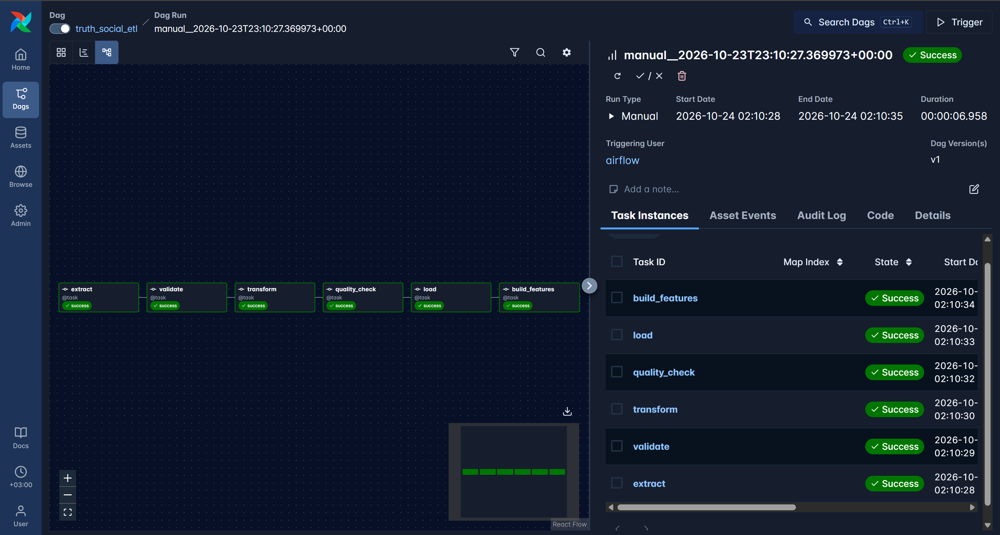
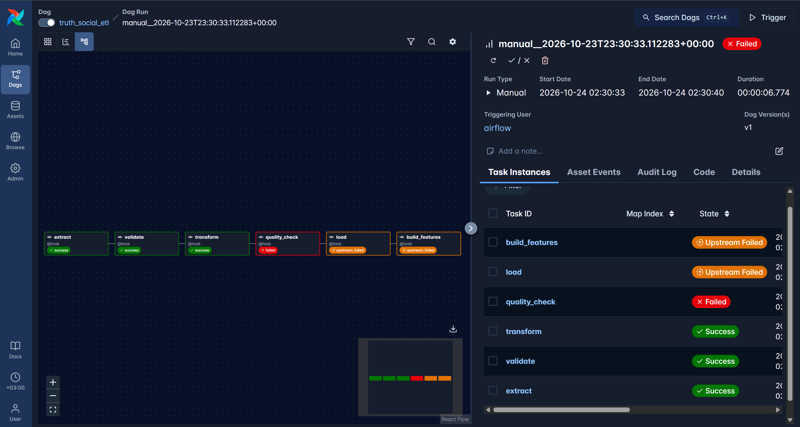

# mlops-labs

Predictive alerts for abnormal S&P 500 moves around Trump's Truth Social posts (AI290 MLOps, KSE).

## Problem

Posts by Donald Trump on Truth Social appear at any time of day and are sometimes followed by sharp moves in the stock market. This project builds a service that, for every new post published during US market hours, estimates the probability that the S&P 500 makes an abnormally large move over the next two hourly bars. A move is abnormal when its absolute log return exceeds 1.5 standard deviations of the same time-slot return over the previous 20 trading days, so the task is binary classification. The service raises an alert for the top 20% of posts by predicted probability, so that an analyst looks at the market sooner. It is a predictive tool only and makes no causal claim that a post causes a market move.

Full design: [docs/design.md](docs/design.md).

## Maturity scorecard

| Property | Evidence a reviewer checks | Added in |
|---|---|---|
| Repository reproducible from a clean clone | CI is green; `make setup` and `make lint` succeed on a fresh clone | Lab 1 |
| Design document exists and is current | `docs/design.md` follows the template, every section filled or marked as an assumption | Lab 1 |
| Data versioned | `data/raw.dvc` (hash `d756bd56a53aee1182a62f609dab15bc.dir`), remote in `.dvc/config`; retrieval command and checksum in [Data](#data) | Lab 2 |
| Pipeline idempotent | `dags/truth_social_etl.py`; row counts after two runs of one month in [ETL pipeline](#etl-pipeline) | Lab 2 |
| Quality gate present | `src/mlops_labs/quality.py`; failed task screenshot [`docs/screenshots/red_airflow.png`](docs/screenshots/red_airflow.png) | Lab 2 |
| Experiments tracked | MLflow experiment `truth-social-abnormal-moves`, [`docs/screenshots/mlflow_runs.png`](docs/screenshots/mlflow_runs.png); results in [Experiments](#experiments) and design 7.2 | Lab 2 |
| Model registered with lineage | model `truth-social-abnormal-move` version 2, alias `champion`, tags `data_version` and `git_commit`: [`mlflow_registry.png`](docs/screenshots/mlflow_registry.png), [`mlflow_version2.png`](docs/screenshots/mlflow_version2.png); `scripts/reproduce.py` | Lab 2 |

## Setup

```bash
make setup   # uv sync: creates .venv and installs pinned dependencies
make lint    # ruff check
```

Without `make` (e.g. Windows):

```powershell
uv sync
uv run ruff check .
```

## Data

- Posts: [chrissoria/trump-truth-social](https://huggingface.co/datasets/chrissoria/trump-truth-social) on Hugging Face (CC-BY-NC-4.0).
- Prices: hourly `^GSPC` bars from Yahoo Finance via `yfinance`.

`data/raw/` is git-ignored and versioned with DVC.

- **Remote type:** S3-compatible MinIO from the compose stack (`s3://dvc` at `http://localhost:9000`). The remote URL is committed in `.dvc/config`; the credentials are not (they go into `.dvc/config.local`).
- **Retrieval on a clean clone** (stack running, see [Reproduce Lab 2](#reproduce-lab-2)):

```bash
uv run dvc remote modify --local minio access_key_id "<MINIO_ROOT_USER from .env>"
uv run dvc remote modify --local minio secret_access_key "<MINIO_ROOT_PASSWORD from .env>"
uv run dvc pull
```

- **Checksum of what arrives:** directory hash `d756bd56a53aee1182a62f609dab15bc.dir` (2 files, 14,893,864 bytes), files `gspc_1h.csv` md5 `1f25755a2e20c674d4fe07faba6fc9f4` and `train-00000-of-00001.parquet` md5 `695d94551fcdba1f9c2a37090c161ae9`. Checked with a fresh `git clone` followed by `dvc pull`.
- **Size:** 14 MB, so no sampling was needed.

## Reproduce Lab 2

```bash
uv sync
cp .env.example .env            # then set the passwords
docker compose up -d --build    # MinIO, PostgreSQL, MLflow, Airflow
uv run dvc pull                 # credentials as in the Data section
uv run python scripts/trigger_months.py          # 35 monthly DAG runs, one after another
uv run python -m mlops_labs.train --register     # baselines, candidate, registry (commit first)
uv run python scripts/reproduce.py               # rebuild the champion from its tags
cd feature_repo && uv sync && uv run feast apply && uv run python demo.py
```

The UIs are at `localhost:8080` (Airflow), `localhost:5000` (MLflow) and `localhost:9001` (MinIO). `make months`, `make train`, `make reproduce` and `make feast-demo` run the same steps.

## ETL pipeline

The DAG `truth_social_etl` has six tasks: `extract`, `validate`, `transform`, `quality_check`, `load`, `build_features`. The batch is one calendar month. It comes from the run's data interval for scheduled runs or from the `month` parameter for manual runs, never from the clock.

**Data interval choice.** The DAG declares the interval explicitly with `schedule=CronDataIntervalTimetable("@monthly", timezone="UTC")` (Airflow 3 would otherwise give `data_interval_start == data_interval_end`). A manual run for one month sets `month` and then ignores the interval.

**Idempotency.** `load` replaces the month with delete-then-insert in one transaction. The same month (`2025-03`) run twice gives identical row counts (warehouse tables, query below):

```text
 run 1, before the rerun            run 2, after the rerun
 raw_posts    638                   raw_posts    638
 clean_posts  138                   clean_posts  138
 features     110                   features     110
```

```sql
SELECT 'raw_posts', count(*) FROM raw_posts WHERE batch='2025-03'
UNION ALL SELECT 'clean_posts', count(*) FROM clean_posts WHERE batch='2025-03'
UNION ALL SELECT 'features', count(*) FROM features WHERE batch='2025-03';
```

All 35 months (2023-12 to 2026-10) were loaded: 35 batches, 3,623 feature rows.

**Quality gate.** `quality_check` runs nine checks between `transform` and `load` (list in design 6.6). It was tested by breaking one month on purpose: `uv run python scripts/make_bad_batch.py 2025-03` copies `data/raw` to `data/raw_bad` and blanks all 638 texts of March 2025, as if the source had started sending only media or reposts; the DAG is then triggered with `{"month": "2025-03", "raw_dir": "/opt/airflow/data/raw_bad"}`. The task fails with `QualityGateError: quality gate failed (1 checks): empty_text_share: 100.0% empty texts, maximum 60%`, `load` and `build_features` do not run, and the warehouse keeps the counts above.

| Successful run | Failed gate |
|---|---|
|  |  |

## Features

`build_features` fills the table `features` (column `feature_version = v1`) from the cleaned rows. Design 5.3 states the serving-time source of every feature. The optional Feast part (`feature_repo/`, own environment because Feast pins pandas below 3) serves σ per time slot: `feast apply` and `demo.py` show that a timestamp between two feature rows returns the earlier row, that the store returns exactly the training value for all 3,623 posts (maximum difference 0.0), and that the online store holds the newest row.

## Experiments

Time split (design 5.4): train to 2025-06-30, validation 2025-07-01 to 2025-12-31, test from 2026-01-01; 2,266 / 437 / 920 rows. Alert rate 20%, threshold set on validation.

| Model | PR-AUC validation | PR-AUC test | Coverage at 20% alerts, test |
|---|---|---|---|
| B0 constant prior | 0.112 | 0.141 | 0.146 |
| B1 keyword rule | 0.147 | 0.153 | 0.285 |
| B2 context only | 0.208 | 0.185 | 0.162 |
| Candidate (TF-IDF and context, logistic regression) | 0.172 | 0.182 | 0.223 |

**The rule beats the model.** The candidate is not better than the context-only baseline B2 (difference on test -0.003, 95% interval [-0.101, +0.078]), and no model reaches the 40% coverage target. Text adds nothing measurable here. The registry tag `beats_best_baseline_on_val=false` says so; details in design 7.2.

## Registry and reproduction

Every run logs its parameters, metrics and two tags: `data_version` (the DVC hash) and `git_commit`. The candidate is registered as `truth-social-abnormal-move` with the same two tags and the alias `champion` (the name Lab 4 loads by). `train` refuses to register when the data version is unknown, when code has uncommitted changes, or when the warehouse was built from another data version than `data/raw.dvc`.

```bash
uv run python scripts/reproduce.py        # default: models:/truth-social-abnormal-move@champion
```

It reads the two tags of the model version, checks that the code equals the tagged commit (otherwise it prints the `git checkout` to run), restores `data/raw.dvc` from that commit if the data version changed and runs `dvc pull`, trains again from `data/raw` with the same parameters, and compares validation and test PR-AUC with the original run.

**Tolerance: 0.005 absolute PR-AUC.** On the same lock file and seed the reproduced value equals the original (difference 0.00000), also between Linux and Windows after one fix: a first version cut the TF-IDF vocabulary with `max_features`, which tied on 231 terms and broke the ties differently on the two machines (validation PR-AUC 0.162 and 0.173); the vocabulary is now cut by `min_df` only. The tolerance covers last-digit numerical noise of the solver and BLAS; it does not cover a changed data version, vocabulary or library versions, which move the metric by 0.01 or more.

## Use of AI tools

I used Claude as an assistant for Lab 1:

1. Topic discussion and ideation
2. Data research and analysis
3. Drafting the design document, architecture diagrams and README
4. Architecture planning

For Lab 2:
1. plan the stages and to
2. write the first versions of the compose stack, the ETL code and DAG, the quality gate, the features, the training and reproduction scripts, the Feast repository, the tests, and the updates of README and of the design doc

This part is written by me, by hand. Everything is reviewed, verified and approved by me.
