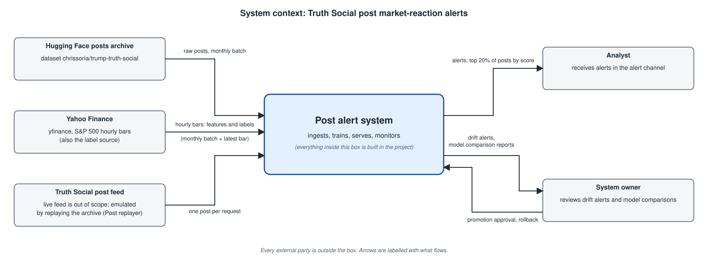
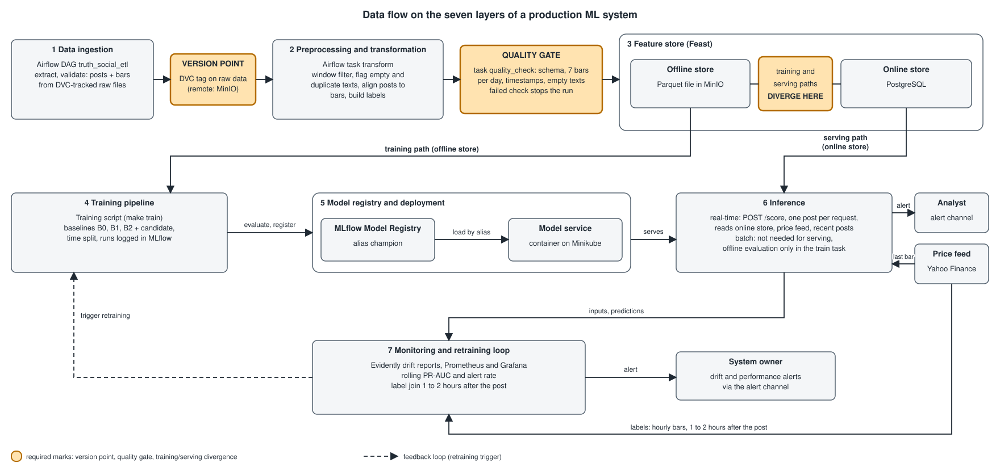
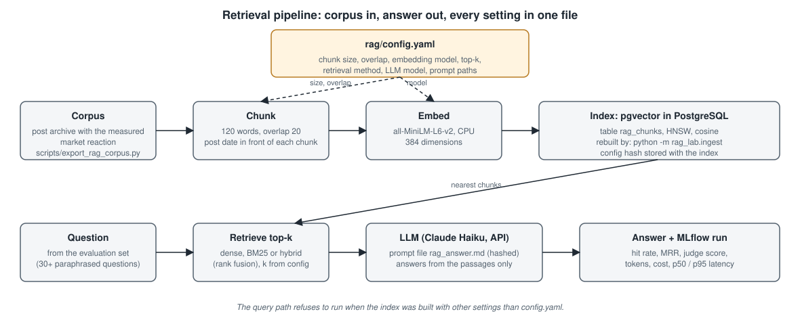
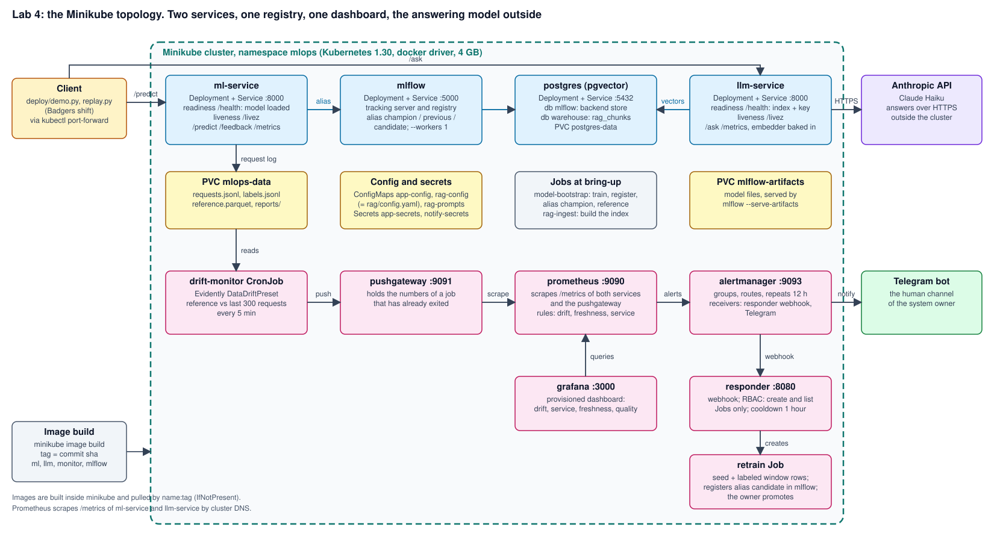
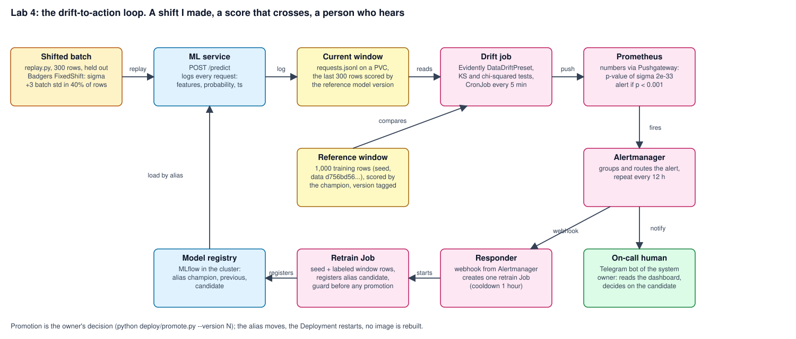

# Design document: Truth Social post market-reaction alerts

Author: Bohdan Kolisnyk · Course: AI290 MLOps · Status: Lab 1 draft

## 1 Overview

Posts by Donald Trump on Truth Social are sometimes followed by sharp moves in US equities. This project builds a system that receives each new post as it is published, scores it, and estimates the probability that the S&P 500 makes an abnormal move, one larger than usual for that time of day, between the start of the hourly bar that contains the post and the end of the next hourly bar, during the regular US trading session. The highest-scoring posts, about one in five, are sent to a market analyst as alerts. The desired outcome is that flagged posts are clearly more likely to be followed by a large move than a typical post, and that the model keeps up with new data and changing market regimes. The system is a predictive alerting tool: it does not place trades and it makes no claim that posts cause market moves.

## 2 Motivation

**Consumer.** A discretionary trader or analyst who watches US equity indices (a US500 CFD, with the S&P 500 as the proxy) and wants to know which posts deserve immediate attention.

**Volume and frequency.** The archive holds 36,924 posts since February 2022. Since December 2023 (the start of the price history the system keeps, section 5.2), about 4,900 posts fall inside the window used by the model (trading days, 09:30–14:30 ET): roughly 8 per trading day, and up to 44 in a single hour. Posts come in bursts: about 84% of in-window posts share an hour with another post.

**Why a system and not a notebook.** Posts arrive one at a time and at any hour, and each must be scored within about a minute, before the market reaction is over. The data is non-stationary: topics (for example tariffs in 2025), posting behaviour and market volatility all change. The true outcome is known one to two hours after each post, so the model can be monitored against real labels and retrained regularly. A one-off notebook cannot do any of that.

**Cost of errors.** A false alarm wastes the analyst's attention and trains them to ignore alerts. A missed alert means a missed move. No money moves automatically, so both errors are bounded.

## 3 Success metrics

Reference numbers in this section come from a prototype of the label in section 5.1 (k = 1.5), computed on the hourly price series of section 5.2; Lab 2 recomputes them in the pipeline. The base rate of abnormal moves is 14.5% in the training period, 16.0% in validation and 13.6% in the 2026 hold-out. For comparison, 14.5% of all two-bar windows in the same period are abnormal by the same rule, with or without a post, so posts as a group are not followed by more abnormal moves than an average window. Any value of the system must come from telling posts apart by their text and context.

The operating point is an alert rate: the top 20% of scored posts by `p_abnormal` become alerts, which is 1.2 to 1.8 alerts per trading day depending on posting volume. The rate of 20% is above the base rate of every period, so a perfect model could catch all abnormal moves at this rate, while the load stays at one or two alerts per day. Random alerting at the same rate catches about 20% of abnormal moves, with precision equal to the base rate.

| Layer | Metric | Target |
|---|---|---|
| Business / decision | Coverage of big moves: share of abnormal-move posts that receive an alert at the 20% alert rate | At least 40%, twice random alerting (assumption; the Lab 2 results in 7.2 reach 0.16 to 0.29 on the hold-out, so the target is not met and is kept for Labs 3 and 4) |
| Business / decision | Analyst load | One or two alerts per trading day on average, at most 20% of scored posts (assumption about one analyst's capacity) |
| Model | PR-AUC on validation and hold-out (optimization metric; threshold-free) | Above the better of baselines B1 and B2 (section 5.3), by a margin shown with a bootstrap interval. No absolute target: since posts as a group show no excess of abnormal moves, failing to beat the baselines is a possible outcome and would be reported as such |
| Model | Calibration of `p_abnormal` (satisficing) | Reliability curve and Brier score reported; no alert threshold is chosen from an uncalibrated score |
| System | Score latency, p95 | At most 500 ms per post (assumption) |
| System | Freshness | Score available at most 60 s after the post reaches the system (assumption; measured on the replayed stream); training data refreshed monthly |
| System | Availability during the trading session | 99% (assumption for a single local instance) |

The business metrics describe what the analyst gets at the chosen operating point. The model metrics describe ranking quality across all thresholds. PR-AUC is the optimization metric; the alert rate, calibration and latency are satisficing constraints.

## 4 Requirements and constraints

### 4.1 Functional requirements

- **Input (online path):** one post per request: `post_id`, `text`, `created_at` (UTC), `has_media`. The service adds market context itself from the hourly price series: the volatility reference σ for the post's time slot and the return of the last completed hourly bar.
- **Output (JSON):** `in_window` (whether the post falls between 09:30 and 14:30 ET on a trading day), `p_abnormal` (probability), `alert` (true if the post is above the alert threshold), `model_version`, and a `fallback` flag. Posts outside the window return `in_window=false` and no score: the label needs the post's hourly bar and the next one inside the same session, and the model is trained only on in-window posts.
- **Callers:** the post-stream consumer calls the service once per new post (in this project, a replay script). Alerts go to the analyst's channel (assumption: a simple chat bot or dashboard). In Lab 5 an agent calls the same endpoint as a tool.
- **Batch path:** a monthly pipeline ingests the latest posts and price bars, builds labels, retrains and evaluates.

### 4.2 Non-functional requirements

| Category | Requirement |
|---|---|
| Freshness | Online: a score at most 60 s after a post arrives (assumption). Batch: posts and price bars refreshed monthly. Labels are available one to two hours after each post. |
| Latency and throughput | p95 at most 500 ms per post. The service receives every post, in the window or not; the peak measured on the archive is 67 posts in one hour, about one per minute, so a single instance is enough. |
| Availability and fallback | 99% during the trading session (assumption). If the model or the price feed is unavailable, return the keyword-rule baseline score (B1) with `fallback=true`. |
| Reproducibility | Every run is tied to a git commit, a data version (DVC, covering both the posts and the price bars) and the pinned environment (`uv.lock`). One command rebuilds the pipeline. |
| Adaptability | New monthly batches enter through a scheduled pipeline. A new model replaces the current one only after beating it on the latest period and being approved by a person (alias `champion` in the registry). |
| Observability without ground truth | Monitor input drift (text length, time slot, σ, text features), prediction drift (alert rate) and data quality (missing post fields, timestamps, and bar completeness: 7 bars on a full trading day, fewer only on scheduled half-days). Real labels arrive one to two hours later, so rolling performance is monitored too. |
| Cost and resources | Everything runs locally on a laptop (Minikube with 4 GB). Cloud cost is only estimated in section 6.7. |

### 4.3 Scope

**In scope:** Truth Social posts from the archive, replayed in time order as a stream for online scoring; the S&P 500 index on hourly bars as the single target; posts published on trading days between 09:30 and 14:30 ET; binary "abnormal move" prediction; monthly batch ingestion and retraining; monitoring.

**Out of scope:** live collection from Truth Social (terms of service; the stream is emulated by replaying the archive), order execution or any trading strategy, other instruments or assets, direction (up or down) prediction, posts outside the window (outside the regular session this is about 70% of the posts that carry a market-period flag; the index has no price outside the session), other sources such as the Twitter archive (a possible later extension), and causal claims about the effect of posts on the market (the system only predicts).

## 5 Methodology

### 5.1 Problem statement

Binary classification. Let `c` be the hourly bar (bars start at 09:30, 10:30, … ET) that contains the post, and `r = log(close(c+1) / open(c))` the index return from the start of that bar to the end of the next one. Then `y = 1` if `|r| > k * sigma`, where `sigma` is the standard deviation of the same two-bar return, starting at the same time of day, over the previous 20 trading days. `sigma` uses only past data and adjusts for the intraday pattern (the first bar after the open is the most volatile).

The window of `r` starts up to 60 minutes before the post and ends 60 to 120 minutes after it. Hourly bars give no finer timing (section 5.2); the part before the post is a known source of noise and of reverse timing (see "Scope of the claim").

`k` is a design choice, not a derived quantity. The starting value is k = 1.5, fixed for statistical power: with k = 2 the validation set contains only 33 abnormal examples, against 98 with k = 1.5 (section 5.4). Results are also reported for k = 1 and k = 2 as a sensitivity check.

**Rejected framing: predicting the direction or the signed return.** In the data, the signed return `r` is centred at zero (mean about 1 bp, standard deviation about 38 bp), so the direction is close to a coin flip. The magnitude of a move matters for risk and is a more learnable target.

**Scope of the claim.** The model predicts association, not causation: it estimates how likely an abnormal move is around a post, given the text and market context. It does not show that the post caused the move. Posts are often reactions to news that moves the market anyway (confounding), and the label window starts before the post, so part of a move can come first (reverse timing). Answering the causal question needs causal inference methods (for example an event study against matched control windows, difference-in-differences, or synthetic control). The prototype already shows why this matters: the share of abnormal windows after posts (14.4%) is the same as across all windows (14.5%). This is out of scope for the project (section 4.3) and appears as a risk (6.9) and a rejected alternative (7.1).

**LLM component (Lab 3).** The LLM does the same job as the Lab 2 model, zero-shot: it reads a post and its time and returns the probability that the S&P 500 makes an abnormal move over the next two hourly bars. Its metric is the Lab 2 metric (PR-AUC on test posts), so it sits next to B0 to B2 and the candidate. Beside it runs a retrieval pipeline over the corpus of the project: the Truth Social post archive of section 5.2 together with each post's measured reaction (abnormal move yes or no, two-bar return), 3,443 posts after removing empty and repeated texts and posts shorter than 40 characters, public (CC-BY-NC-4.0, Hugging Face `chrissoria/trump-truth-social`), versioned with DVC like the rest of the data. Over this corpus the LLM answers analyst questions ("what did he say about X around month Y, and what did the market do?") from the retrieved passages. The retrieval part is graded as an auxiliary job with an answer metric; the zero-shot part is graded as a baseline.

### 5.2 Data

**Sources.**

1. **Posts.** Hugging Face dataset `chrissoria/trump-truth-social` (licence CC-BY-NC-4.0, so non-commercial use only, which fits coursework). 36,924 posts, 2022-02-14 to 2026-10-16, 187 columns: post text and timestamps, price snapshots for 18 tickers, GDELT news indicators, and LLM-assigned post categories from 2024-11-05. Only the post fields are used; the price columns are not (see the known issues).
2. **Prices.** Hourly bars (open, high, low, close) of the S&P 500 index (^GSPC) from Yahoo Finance via the yfinance library. The first download covers 2023-11-17 to 2026-10-16: 5,082 bars on 730 trading days.

**Arrival pattern.** There are two paths.

- **Online:** posts arrive one at a time, at any hour, and each post is scored on arrival. In this project the live feed is emulated by a replay script that sends archive posts to the service in time order (live collection is out of scope).
- **Batch:** the post archive is refreshed by its maintainer (daily, according to its documentation), and new price bars are appended from the source. The training pipeline ingests both as monthly batches.

**Usable rows.** Posts on trading days between 09:30 and 14:30 ET, so that the post's bar and the next one are full bars of the same session (the session runs 09:30–16:00 ET and its last bar, 15:30–16:00, lasts half an hour). Holidays have no bars, and on half-days the window shrinks automatically because both bars must exist. The label needs 20 earlier trading days for σ, so the first labelled post is from 2023-12-18. Result: **4,877 labelled posts** up to 2026-10-16, on 621 trading days, about 7.9 per day. 3,741 of them have non-empty text.

**Labels and delay.** The label is known at the close of bar c+1, which is one to two hours after the post.

**Batch grain and data version (as built in Lab 2).** The batch is one calendar month of posts (`YYYY-MM`, taken from the Airflow data interval or from the `month` parameter, never from the clock); the smallest month in the archive has 52 usable posts. The raw directory `data/raw` (the posts parquet and the hourly bars CSV, 2 files, 14,893,864 bytes) is versioned with DVC; the data version identifier is its DVC hash, `d756bd56a53aee1182a62f609dab15bc.dir`, stored in `data/raw.dvc` and written into the `data_version` column of every cleaned row and into the tags of every MLflow run. The remote is the compose MinIO, bucket `dvc`. The labels, the cleaning flags and the features are computed on the whole archive and then cut to the month, so they depend on the data version and not on the order of the runs. The pipeline reproduces the numbers above (`tests/test_real_data.py`): 4,877 labelled posts on 621 days, 1,136 empty texts, 118 duplicates.

**Training time versus serving time.**

| Field | Training | Serving |
|---|---|---|
| Post text, timestamp, media flag | archive | request |
| Return of the last completed hourly bar | hourly bars | price feed at request time (in replay: the hourly bars) |
| σ for the post's time slot | hourly bars | online feature store, refreshed daily |
| Bars c and c+1 | used only to build the label | not available at the time of the post |
| Dataset price columns `sp500_*` | not used | not used |
| GDELT indicators, LLM categories | archive | not used (see section 5.3) |

**Checklist justification.**

- **Time axis.** Every post has a timestamp to the second and every bar has a start time, so monthly batches can be ingested in Lab 2 and a shift can be injected in Lab 4.
- **Enough history to hold out.** About two years and ten months of hourly bars (2023-11-17 to 2026-10-16). The hold-out is 2026 (see section 5.4).
- **Labels with known delay.** One to two hours after the post. This makes monitoring close to real time: rolling performance can be computed with a lag of two hours.
- **Text surface.** The posts themselves are the text. The Lab 3 retrieval corpus is the post archive together with each post's measured market reaction.

**Known data issues and the plan for each.**

- **The dataset's own prices are not aligned with the post time.** On 4,652 posts covered by both sources, `sp500_at_post` equals the close of the hourly bar that contains the post in 99.6% of cases, that is, a price up to 60 minutes after the post. `sp500_1hr_after` equals the close of the second bar after it in 89% of cases, 2 to 3 hours after the post and on the next day for afternoon posts. A label built on these columns would measure the wrong window. Plan: do not use them; all prices come from source 2.
- **Mixed granularity in the dataset.** Its intraday prices are hourly for most rows but 5-minute, 1-minute or unflagged for recent ones (the source keeps fine bars only for days or weeks). Plan: resolved by source 2, which has one granularity (hourly bars starting at :30 ET) for the whole period. Bar completeness per day is monitored as a data-quality check.
- **Limited retention of hourly bars.** The source provides hourly bars only for about the last two years, so bars older than that cannot be downloaded again. Plan: the downloaded file is the system's own record of prices; it is versioned with DVC and extended every month by the ingestion pipeline. This is also why the labelled history starts in December 2023.
- **Coarse timing.** With hourly bars the label window starts up to 60 minutes before the post. Plan: accept it, state it in the label definition (section 5.1), and list reverse timing as a risk (6.9).
- **Empty and duplicate texts.** 23.3% of in-window posts have no text (media or reposts) and 118 texts are duplicates. Plan: drop empty texts and deduplicate in preprocessing. As built: the `transform` task keeps every labelled row in `clean_posts` and flags it (`text_empty`, `dup_text`); only the rows with neither flag reach the `features` table (3,623 of 4,877).
- **Bursts.** About 86% of in-window posts share an hour with another post (measured in Lab 2; the first draft said 84%), so observations are not independent. Plan: time-based split and grouping by hour.
- **Dataset flag for market hours.** `during_market_hours` uses 09:30–16:00 ET, which is wider than our window, and it is missing for posts after 2026-03-23. Plan: derive the window ourselves from the UTC timestamp (America/New_York) and the trading days in source 2.

### 5.3 Techniques

**Baselines, in order.**

1. **B0: constant prior.** Every post gets the same score (the training base rate).
2. **B1: keyword rule.** The score is the number of hits from a fixed list of market-relevant terms (tariff, China, Fed, and similar). B1 is also the fallback of the service (section 4.2).
3. **B2: context-only model.** A simple model on the time slot, σ and the return of the last completed bar, with no text. It shows whether the text adds anything at all.

**Candidate.** Text features (TF-IDF or sentence embeddings) plus the context features below, with logistic regression or a gradient-boosted model. Lab 3 adds a zero-shot LLM baseline for comparison.

**As built in Lab 2.** B1 counts hits of 30 fixed market terms (the list is fixed before looking at labels and its hash is logged). B2 is a logistic regression on the one-hot time slot, σ, the last bar return and its absolute value. The candidate is TF-IDF of the text (word 1 to 2-grams, `min_df=5`, 4,263 terms on the training period) plus the ten scaled numeric features of the table below, into a logistic regression with C=1. The vocabulary is cut by `min_df` only: a first version with `max_features=5000` tied on 231 terms with the same count at the boundary, and the sort that broke the ties differs between machines, so Linux and Windows trained different models (validation PR-AUC 0.162 against 0.173). Dropping the top-k cut fixed it, and a test guards it. The feature table has a `feature_version` column (`v1`).

**Features and their serving-time source.**

| Feature | Serving-time source |
|---|---|
| Text features (TF-IDF or embedding) | request body |
| Text length, media flag, link count, share of capital letters | request body |
| Time slot (hourly bar), weekday, minutes since the open | derived from the request timestamp |
| σ for the post's time slot | feature store, online side (refreshed daily) |
| Return of the last completed hourly bar | price feed at request time (in replay: the hourly bars) |
| Number of posts in the previous 60 minutes | recent posts table (database) |

**Excluded on purpose.** The bars c and c+1 (they define the label). All `sp500_*` columns of the dataset (not aligned with the post time, section 5.2). GDELT indicators (timing unclear). LLM categories (available only from 2024-11-05, about 20% coverage).

**Training-serving skew example.** The number of posts in the previous 60 minutes and the return of the last completed bar must be computed as of the post timestamp. A careless join on the hour in training would count posts published later in the same hour, or use the bar that contains the post, which the serving path cannot see. Training therefore uses point-in-time joins for these features.

**LLM and retrieval techniques (Lab 3).** (1) Zero-shot classification: one prompt file (`rag/prompts/zero_shot_label.md`) states the label definition and the base rate and asks for a JSON probability. (2) Chunking of posts into windows of 120 words with an overlap of 20; the post date is put in front of each chunk so a question about a period has something to match. (3) Embedding with the local model `all-MiniLM-L6-v2` on CPU (384 dimensions, normalised). (4) Index in pgvector (HNSW, cosine distance) in the warehouse PostgreSQL. (5) Retrieval of the top-k chunks, by cosine similarity (dense), by BM25 keyword scores over the same chunks with the month of the post date as an extra token, or by a hybrid that fuses both rankings by reciprocal rank (50 candidates from each), and an answer prompt (`rag_answer.md`) that allows only the passages as source and that shows the measured market reaction next to each passage. (6) LLM-as-judge for the answer metric with its own prompt file (`judge.md`). Every setting of 2 to 5 lives in `rag/config.yaml`; the index stores a hash of the settings and of the corpus (post ids and texts) that built it, and the query path refuses to run on a different one, which is the retrieval equivalent of training-serving skew.

### 5.4 Experimentation and validation

**Split by time, never random.** A random split would mix periods and let the model see the market regime and near-duplicate posts from the future.

| Set | Period | Labelled posts | Abnormal (k = 1.5) |
|---|---|---|---|
| Train | 2023-12-18 to 2025-06-30 | 3,056 | 442 (14.5%) |
| Validation | 2025-07-01 to 2025-12-31 | 613 | 98 (16.0%) |
| Test (hold-out) | 2026-01-05 to 2026-10-16 | 1,208 | 164 (13.6%) |

These are prototype counts for all labelled posts; the Lab 2 pipeline reproduces them exactly. After the cleaning rules (empty and duplicate texts are dropped) the training table has 2,266 train, 437 validation and 920 test rows with 323 (14.3%), 49 (11.2%) and 130 (14.1%) abnormal moves, and all baselines and the candidate are evaluated on these rows. Intervals are bootstrap resamples by hour (1,000 draws, seed 0). The alert threshold is set on validation and kept fixed on test; posts whose scores tie (every post for B0, most posts for B1) are ranked by a seeded random tie-break, so every model alerts on exactly 20% of validation posts. Expanding-window cross-validation by month on the training period is logged as `cv_pr_auc_mean`. Split boundaries fall between calendar half-years, so posts of the same hour never straddle a boundary. Inside the training period, use expanding-window cross-validation by month. The validation set has 98 positive examples, so confidence intervals are wide; results are reported with a bootstrap by hour.

**Alert threshold.** Set on the validation period so that 20% of posts are flagged, then kept fixed on the hold-out. The alert rate on new data is monitored (section 4.2).

**Offline metrics.** PR-AUC (optimization). Coverage and precision at the 20% alert rate, and calibration (satisficing).

**Comparing a new model with the current one.** Both are evaluated on the most recent period. A challenger is promoted only if it improves PR-AUC and coverage at the 20% alert rate, with a bootstrap confidence interval that resamples by hour so that clusters are not split. Promotion is approved by a person (section 5.5).

**Evaluating the LLM component (Lab 3).** The evaluation set is `rag/eval/eval_set.jsonl`: 51 questions, each with the identifier of the relevant post and a reference answer. The questions were generated by Claude Haiku from sampled posts (prompt `gen_question.md`, hashed) and read by the author; a question is rejected in code if it shares a run of four words with its post, so the metrics are not saturated by string overlap. Metrics: hit rate at k and mean reciprocal rank, computed by `rag_lab/core.py`; an answer score from an LLM judge (1 to 5 against the reference, divided by 5). Five quality measures named after the usual RAG-evaluation terms (RAGAS) come from three more judge prompts: groundedness (faithfulness: share of the answer's claims supported by the retrieved passages), hallucination rate (share of answers with an unsupported claim), answer relevance (1 to 5, facts ignored), context completeness (how much of the reference answer the passages hold, 0 to 2) and context utilization (share of passages that support a claim); a declined answer ("the passages do not contain it") is counted apart. One parameter is varied at a time (top-k in 1, 3, 5, 10, and the retrieval method dense, BM25 and hybrid; tables in 7.2), every value is an MLflow run in the experiment `truth-social-llm-rag`. Bias: the same model family generates the questions and answers them, which favours questions that this family finds easy; it is reduced by the no-quote filter, by reading every question, and by judging against reference answers taken from the post and not from the model's own output. The evaluation set tests the retriever and the answer step, not the corpus (it only contains posts that exist) and not questions whose answer is spread over many posts. Each question has one relevant post, although the archive holds near-duplicates of a topic, so the hit rate understates retrieval quality. The set is small (51 questions, 51 of 120 sampled posts survived the no-quote filter), which limits what a difference between two settings can show.

### 5.5 Human in the loop

All roles are played by one person, but they are kept separate in the design.

- **Analyst:** receives the alerts of the model (top 20% of posts by probability) and can mark each as useful or not through `POST /feedback` (optional; the label joins the request log and feeds the quality panel).
- **System owner:** receives every drift and service alert in the Telegram chat of the alert bot (Alertmanager sends it; the bot token and chat id come from `.env`, never from the repository). Reads the Grafana dashboard and the Evidently report of the run that fired, and answers by the end of the next trading day: ignore with a reason, retrain, or roll back.
- **Approval of a promotion:** nothing promotes itself. A drift alert makes the responder start one retrain Job that registers the new version under the alias `candidate` and tells the owner in the same chat; the owner compares it with the champion in MLflow and runs `python deploy/promote.py --version N`, which moves the alias `champion`, restarts the Deployment and checks `/predict` (no image is rebuilt). The setting `RETRAIN_PROMOTE=guarded` is the optional automatic path: it promotes only when the candidate's validation PR-AUC is at least the champion's minus 0.02 and its PR-AUC on the newest labelled window is higher; the default is `never`.
- **Override:** `python deploy/promote.py --rollback` moves `champion` back to the version kept under `previous`. The alert threshold of the model is a tag of the model version (`alert_threshold`, the top 20% of validation scores); the drift thresholds are values in the ConfigMap `app-config`. The analyst can mute the alert channel, and the responder starts at most one retrain Job per hour (cooldown) so that a noisy drift cannot flood the cluster.

## 6 Implementation

### 6.1 High-level design

The three diagrams below use the same component names as section 6.2.

**System context.**

**Data flow on the seven layers.** The version point (DVC tag on the raw data), the quality gate (end of preprocessing, before the feature store) and the point where the training path and the serving path diverge (offline and online sides of Feast) are marked in orange.

In Lab 2 the layers are these Airflow tasks of the DAG `truth_social_etl`, chained with `>>`: `extract`, `validate`, `transform`, `quality_check`, `load` (raw and cleaned rows into the PostgreSQL warehouse, delete-then-insert per month), `build_features` and `materialize` (the newest σ of every time slot from the Feast offline store to the online store). The quality gate runs before `load`, so a bad month never reaches the warehouse.

**What the tasks pass to each other.** Only metadata. A task gets its batch from the run context, reads its input from the warehouse (the scratch tables `stg_posts` after `extract` and `stg_clean` after `transform`) or from the raw files, writes its output there and returns a few counters as its XCom (batch, row counts, check results). Nothing is passed as a task argument or return value between tasks, and no data is kept on the local disk of an Airflow container. `load` copies the scratch tables of the batch into `raw_posts` and `clean_posts` in one transaction.

**Serving path.** `scripts/predict.py` takes the text and the time of a post and scores it with the registered champion: the post is placed in its hourly bar and time slot, σ of the slot is read from Feast (point in time from the offline store by default, `--online` for the newest value from the online store), the other features are built by the same function as in training (`compute_features`), the model is loaded from the registry by the alias `champion`, and the probability is compared with the alert threshold (the top 20% of the validation scores). `scripts/predict.py --check N` scores N test posts from text and time only and shows that the result equals the training table (maximum difference 0).

**Retrieval pipeline (Lab 3).** Ingestion (top row) builds the vector index from the corpus; the query path (bottom row) retrieves, prompts and logs. One configuration file holds every setting; `python -m rag_lab.ingest` rebuilds the index and prints the document count. Retrieval is dense, BM25 or a rank-fused hybrid; BM25 is built in memory from the stored chunks and needs no separate index.

**Deployment as built in Lab 4.** One namespace `mlops` on Minikube. The two services, the registry and the database are Deployments with Services; the model files and the request log live on PersistentVolumeClaims; the first model and the vector index are built by two Jobs at bring-up; the drift job is a CronJob; Prometheus, the Pushgateway, Alertmanager and Grafana watch everything; the responder turns a drift alert into one retrain Job. The images are built from the repository inside Minikube and tagged with the commit. The answering model is the Anthropic API, outside the cluster.

**Drift-to-action loop.** A shifted batch is replayed through the ML service, which logs every request. The CronJob compares the last 300 logged requests with the reference window (1,000 training rows scored by the champion) and pushes the numbers to the Pushgateway; Prometheus evaluates the rules, Alertmanager routes the alert to the owner on Telegram and to the responder, which starts the retrain Job.

The first-draft diagram of Lab 1 and Lab 2 stays in the repository as [`diagrams/deployment.svg`](diagrams/deployment.svg) for comparison; it showed Airflow and the Compose stack, which are not part of the cluster.

### 6.2 Infra

The local stack follows the course reference stack with its pinned versions. AWS is used as the single reference cloud for the managed equivalents (assumption: one provider keeps the cost estimate in section 6.7 simple; the GCP and Azure equivalents are listed in the course reference table).

| Component | Local reference | Role | First runs in | Managed equivalent (AWS) |
|---|---|---|---|---|
| MinIO | pgsty/silo, S3-compatible | object storage: raw, clean and feature files, DVC remote, MLflow artifacts | Lab 2 | Amazon S3 |
| DVC | DVC 3.67.1 with dvc-s3, remote on MinIO | data versioning of posts and price bars (version point) | Lab 2 | S3 remote |
| PostgreSQL | PostgreSQL 16 (pgvector image) | MLflow and Airflow metadata, the warehouse (`raw_posts`, `clean_posts`, `features` and the scratch tables `stg_posts`, `stg_clean` between ETL tasks), the Feast registry and online store (database `feast`), recent posts, prediction log; pgvector index from Lab 3 | Lab 2 | Amazon RDS for PostgreSQL |
| Airflow | Apache Airflow 3.3.1, LocalExecutor | orchestrator: the monthly ETL DAG `truth_social_etl` in Lab 2 (training is run by `make train`, not by Airflow; the Lab 4 drift job is a Kubernetes CronJob because Airflow stays in Compose, outside the cluster) | Lab 2 | Amazon MWAA |
| Feast | Feast 0.66.0 | feature store, in its own `feature_repo/` environment because Feast pins pandas below 3: the offline source is a parquet file in MinIO (`s3://lake/feast/slot_sigma.parquet`), the registry and the online store are PostgreSQL (database `feast`); the last task of the DAG materializes the online store | Lab 2 | SageMaker Feature Store |
| MLflow | MLflow 3.16.1, PostgreSQL backend, MinIO artifacts | experiment tracking and model registry (alias champion) | Lab 2 | SageMaker with MLflow |
| LLM endpoint | Claude Haiku through the Anthropic API (chosen over a self-hosted model that was measured in Lab 3, see 6.3 and 7.1); the model id lives in `rag/config.yaml`, the key in the environment | LLM baseline and retrieval-augmented answers; embeddings (sentence-transformers, CPU) and the vector index (pgvector, table `rag_chunks` in the warehouse PostgreSQL) run locally | Lab 3 | Amazon Bedrock |
| Model service | image `mlops-labs-ml:<commit>` (FastAPI, uvicorn) on Minikube: Deployment and Service; readiness `/health` answers 200 only when the champion is loaded and has answered a smoke prediction, otherwise 503 with the reason; liveness `/livez` | online scoring: `POST /predict` (a list of posts with their feature values), `/feedback`, `/admin/reload`, `/metrics`; the model is loaded by `models:/truth-social-abnormal-move@champion` and every scored row is appended to the request log | Lab 4 | Amazon EKS with ECR |
| LLM service | image `mlops-labs-llm:<commit>` (FastAPI, CPU torch, the MiniLM embedder baked in): Deployment and Service; readiness needs the API key, an index whose hash matches the config and one probe retrieval (no paid call); liveness `/livez` | `POST /ask`: retrieval from pgvector and an answer from Claude Haiku; settings are the Lab 3 `rag/config.yaml` and `rag/prompts/`, mounted as ConfigMaps | Lab 4 | Amazon EKS with ECR; Bedrock for the model |
| MLflow in the cluster | official 3.16.1 image plus `psycopg2-binary`, PostgreSQL backend, artifacts served by the server (`--serve-artifacts`) from a PVC | registry with the aliases `champion`, `previous` and `candidate`; promotion is an alias move | Lab 4 | SageMaker with MLflow |
| PostgreSQL in the cluster | `pgvector/pgvector:pg16`, databases `mlflow` and `warehouse` | MLflow backend and the `rag_chunks` index (the Compose Postgres of Lab 2 and 3 stays for the pipeline) | Lab 4 | Amazon RDS for PostgreSQL |
| Bring-up Jobs | `model-bootstrap`, `rag-ingest` | train and register the first champion from the committed seed (`deploy/seed/`, the DVC data version is recorded as a tag) and write the reference window; build the vector index, idempotent | Lab 4 | SageMaker Pipelines (lecture only) |
| Evidently | Evidently 0.7.14, in the CronJob `drift-monitor` | `DataDriftPreset` on the 10 input features and a second drift test on the predicted probability, every 5 minutes in the demo (hourly is the production proposal); writes an HTML and a JSON report to the PVC | Lab 4 | SageMaker Model Monitor |
| Prometheus stack | Prometheus 3.2.1 (7 days of data), Pushgateway 1.11.0, Alertmanager 0.28.1, Grafana 11.5.2 with a provisioned dashboard | scrape `/metrics` of both services and the Pushgateway; 13 alert rules; routing; the dashboard with drift, service, freshness and quality rows | Lab 4 | Amazon CloudWatch |
| Responder | stdlib Python webhook, ServiceAccount allowed to create, list and get Jobs in its namespace only | starts one retrain Job per drift alert, at most one per hour | Lab 4 | Amazon EventBridge with a Step Functions task |
| Post replayer | `scripts/replay.py`, outside the cluster | emulated live feed: sends held-out archive rows to `/predict` in batches, baseline or shifted (Badgers) | Lab 4 | Amazon Kinesis |
| Alert channel | Telegram bot, through the Alertmanager `telegram_configs` | delivers drift and service alerts to the system owner | Lab 4 | Amazon SNS |

The cluster itself is Minikube (Kubernetes 1.30.0, docker driver, 4 GB by default; `deploy/up.py` takes `--memory` and `--cpus`); its AWS equivalent is Amazon EKS. Feast stays in Compose: in the cluster the caller sends the feature values with the post, and the bootstrap Job trains from the committed seed table, which is the Lab 2 training table exported once (`scripts/export_seed.py`, 3,623 rows, data version `d756bd56a53aee1182a62f609dab15bc.dir`).

**External services, not run by the project.** Hugging Face hosts the posts archive. Yahoo Finance provides the hourly price bars and the price feed (through the yfinance library).

**Repository tooling, from Lab 1.** uv (pinned environment), ruff (linter), pre-commit, and GitHub Actions (lint on every push).

### 6.3 Performance

**Throughput.** The service receives every post, inside the window or not. The peak measured on the archive is 67 posts in one hour, about one per minute; the average is about 20 posts per day. A single instance of the model service is enough. Monthly training runs on about 5,000 labelled posts and fits on a laptop CPU in minutes (assumption, measured in Lab 2).

**Latency budget per request, p95 at most 500 ms (assumption).**

| Step | Budget |
|---|---|
| Read σ from the online store and count recent posts in PostgreSQL | 50 ms |
| Last completed bar from the price feed (cached: it changes once an hour) | 50 ms with cache, up to 300 ms on a cache miss |
| Text features and model inference | 50 ms |
| Network, serialisation, logging | the rest |

**Batch or online.** Online for scoring: posts arrive at irregular times and the value of an alert decays within the 1 to 2 hour label window, so an hourly batch would deliver some alerts up to 60 minutes late. Batch for everything that does not need to be immediate: ingestion, labels, training and drift reports run as scheduled Airflow DAGs, because labels arrive 1 to 2 hours after the post and the model is retrained monthly. The LLM component of Lab 3 is not on the 500 ms scoring path.

**Measured on Minikube (Lab 4).** `python deploy/benchmark.py` sends requests through the Service and writes [`docs/evidence/benchmark.md`](evidence/benchmark.md); the numbers are copied to 7.3 (one run on the author's machine, so they are indicative; the machine is named in 7.3 and the README). The cluster path has no Feast or price-feed lookups, because the caller sends the feature values; what is measured is therefore the model call, the request logging and the network inside the cluster.

**LLM latency and the inference choice (Lab 3).** Measured on 51 RAG answers at top-k 10 with hybrid retrieval (the serving default) and Claude Haiku through the API: p50 2.14 s and p95 4.05 s per answer (retrieval and embedding of the question add a few tens of milliseconds on CPU). Assumption: an analyst reading an answer tolerates up to 5 s at p95, so the measured 4.05 s fits. This is outside the 300 ms budget of online scoring on purpose: the LLM answers analyst questions and is not in the alert path; the alert path stays with the Lab 2 model. Choice: an API, not a self-hosted model. For this corpus (public, few thousand short posts) privacy is not a cost; the API needs no GPU, and the course stack is CPU-only by assumption (a GPU would be an extra requirement for whoever reruns this); the price is a network round trip, a per-token cost, rate limits, and a dependency on a provider that can change the model behind a name (the model name and the prompt hashes are logged in every run, so a change shows up as a metric shift between runs). Self-hosting was measured and not only argued: Qwen3-4B-Instruct-2507 (Q4_K_M, 2.5 GB) served by Ollama on the author's 8 GB RTX 4060 answers the same 51 questions with an answer score of 0.43 against 0.53 to 0.57 for Haiku, p50 3.7 to 7.2 s and p95 4.7 to 9.2 s (the 5 s assumption holds only in the better run, at k=5), a 13.7 s first call after the model was unloaded, and a higher hallucination rate (0.125 and 0.200 against 0.080 and 0.037, on 24 and 25 answers); details in 7.2. A comparable-quality model would need a larger GPU than this laptop has, so the API stays.

### 6.4 Security

- **Secrets.** MinIO keys, the PostgreSQL password, the chat webhook URL and any LLM API key live in a local `.env` file that git ignores, and in Kubernetes Secrets on Minikube from Lab 4: `app-secrets` (database and Grafana passwords, the API key), `notify-secrets` (the Telegram token and chat id) and `alertmanager-config` (the Alertmanager file that carries the token). `deploy/up.py` reads the key and the Telegram values from `.env` and generates the cluster passwords on the first run into `deploy/.cluster.env`, which git ignores; the pods read the Secrets as environment variables or mounted files, and the Alertmanager config is a Secret, not a ConfigMap, because it holds the token. The DVC remote credentials are kept in `.dvc/config.local`, which git ignores, and only the remote URL is committed. Nothing secret is committed; the Lab 1 CI needs no secrets. AWS equivalent: AWS Secrets Manager.
- **Who may call the service.** The model service is reachable only inside the cluster or through a local port-forward. Its callers are the post replayer and, from Lab 5, the agent. Airflow, MLflow, MinIO and Grafana web interfaces listen on localhost only. In Lab 2 Airflow runs with its all-admins simple auth manager and MLflow without authentication (assumption: a single-user local stack); in Lab 4 all cluster Services are ClusterIP and are reached from the laptop only through `python deploy/ports.py` (kubectl port-forward bound to localhost); MLflow, Prometheus and Alertmanager keep no authentication (same assumption), Grafana has an admin password from the Secret and anonymous read-only access for the screenshots. The responder may only create, list and get Jobs in the namespace `mlops` (a Role, not a ClusterRole), so a stolen alert cannot do more than start retrain Jobs.
- **Supply chain.** The Python environment is pinned by `uv.lock`, and container images use the pinned versions of the reference stack.

### 6.5 Data privacy

- **What personal data the dataset contains.** Public posts by a public figure, with engagement counts and media links. Posts can mention other people by name, including private individuals. No data about the analyst or other users is collected beyond the alert channel address.
- **What is kept and for how long.** Post text, timestamps and the price bars are kept for the duration of the course, versioned with DVC so that every run can be reproduced. Media files are not downloaded, only their links are stored. The prediction log is kept for 90 days (assumption).
- **Deleted posts.** If a post disappears from the upstream archive, it disappears from the next monthly version; older DVC versions still contain it (accepted for coursework, stated here).
- **Licences and terms.** The posts dataset is CC-BY-NC-4.0 (non-commercial use with attribution, given in the README). Yahoo Finance data is used for personal, non-commercial study. The posts and the bars are not published as a dataset: the DVC remote is the local MinIO, not a public bucket. One exception since Lab 4: `deploy/seed/` holds a small derived copy (the training table of 3,623 posts with their features, which include price-derived values such as σ and the last bar return but no raw bars, and the post corpus for the retrieval index), so that a clean clone can bring the cluster up with one command. It keeps the CC-BY-NC-4.0 attribution given in the README, is for non-commercial coursework, and can be removed from the repository without affecting anything except that one-command bring-up.

### 6.6 Monitoring and alarms

**What is logged.** For every request: `post_id`, timestamp, the feature values, `p_abnormal`, `alert`, `model_version` and latency, in the prediction log in PostgreSQL. When bar c+1 closes, the label is joined to the logged prediction.

| What | Metric | Threshold (first draft) | Who receives it |
|---|---|---|---|
| Service health | error rate, p95 latency (Prometheus) | error rate above 1% or p95 above 500 ms for 10 minutes | system owner |
| Data freshness | age of the newest bar and of the newest post in the store | newest bar older than one trading hour during the session; newest post older than 2 days | system owner |
| Data quality | quality gate: schema, bars per full trading day, timestamps, share of empty texts | any check fails (the run stops); share of empty texts in a monthly batch above 60% (measured on the archive: 7% to 45% by month, 23% overall; the first draft said 40%, which would have stopped two normal months, December 2025 and October 2026) | system owner |
| Input drift | Evidently drift score per feature (text length, time slot, σ, keyword share) against the training period | PSI above 0.2 on any monitored feature | system owner |
| Prediction drift | alert rate over the last 5 trading days | outside 10% to 30% (target 20%) | system owner |
| Model performance | rolling PR-AUC over the last 20 trading days, after the label join | below the validation PR-AUC of baseline B2 | system owner; starts the retraining DAG (stretch goal of Lab 4) |
| Alerts for the analyst | `p_abnormal` above the threshold of section 5.4 | top 20% of posts | analyst |

As built in Lab 2, the gate runs nine checks between `transform` and `load`: schema, row count of at least 10, no nulls in key columns, unique `post_id`, timestamps inside the batch interval, post time slot inside the window, share of empty texts, label rate between 0% and 50%, and bars per trading day (7 or 3).

The data freshness alert watches the data itself, not the job status, so a pipeline that succeeds while reading the same stale partition is still caught.

**As built in Lab 4.** The first-draft table above stays as the plan; this is what runs in the cluster and where it differs.

| What | Metric and rule | Threshold | Who receives it |
|---|---|---|---|
| Input drift, the alert | `FeatureDriftSigma`: the Kolmogorov-Smirnov p-value of σ in the current window against the reference window, from Evidently | p below 0.001, critical | system owner (Telegram); also starts the retrain Job |
| Input drift, the breadth | `DriftShareHigh`: share of the 10 monitored input columns that Evidently flags (p below 0.05) | 0.3 or more | system owner; also starts the retrain Job |
| Prediction drift | `PredictionDrift`: the p-value of the predicted probability; `drift_alert_rate` is shown against the reference rate | p below 0.001, warning | system owner |
| Freshness | `RequestLogStale` (no request for 6 hours), `DriftMonitorNotRunning` (no run for 900 s), `DriftMonitorFailed` | as stated | system owner |
| Service | `MLServiceDown`, `MLModelNotLoaded`, `MLRequestLogWriteFailing`, `MLHighErrorRate`, `MLHighLatency`, `LLMServiceDown`, `LLMUpstreamErrors` | down for 1 to 2 minutes; more than 5% of `/predict` requests failing with 5xx for 5 minutes; p95 of `/predict` above 1 s for 5 minutes (looser than the 500 ms budget on purpose, a first-draft value that the benchmark in 7.3 can tighten) | system owner |
| Quality, when labels arrive | `quality_pr_auc`, `quality_precision_at_alert`, `quality_coverage_at_alert` on the labelled rows of the window (at least 30), next to the reference values | shown on the dashboard, not alerted: a window of 300 requests holds too few positives for a stable PR-AUC | system owner |

**Window and schedule.** The current window is the last 300 logged requests scored by the reference model version, with at least 100 required; below that the job pushes only the freshness numbers. The reference window is 1,000 training rows scored by the champion at the moment it was registered, and it is rewritten when a candidate is promoted. The CronJob runs every 5 minutes so that the demonstration finishes in minutes; for production the proposal is hourly (the posts arrive about once an hour on average, so 5 minutes only re-reads the same window).

**Why the threshold is on σ and at p below 0.001.** The consumer of the drift alert is the system owner, who decides on a retrain; the alert must say "the model is now answering a different question", not "the world changed a little". σ, the standard deviation of the same time slot over the previous 20 trading days, is the one feature that defines the label (an abnormal move is one that exceeds 1.5σ), so a shift in σ changes the base rate and the meaning of the alert threshold at once, and the other features only move the score. A strict p below 0.001 is chosen because with 300 against 1,000 rows the usual 0.05 is crossed by ordinary sampling noise and by the slow growth of post length over the years (measured: on the held-out 2026 rows 50% to 70% of the input columns drift against the training rows at p below 0.05, so a share rule alone would alert on real data). The false-alarm rate accepted is below one in a thousand windows for a stable σ; the cost of a miss is a model that keeps alerting on the wrong posts (in the calibration the alert rate fell from 0.24 to 0.09 while the threshold stayed where it was) until the owner notices in the next monthly review, which is why the breadth rule `DriftShareHigh` (0.3) backs it up. Calibration: no shift gives a share of 0.00 and p of σ far above the threshold; σ plus 3 batch standard deviations in 40% of the rows gives p = 2.3e-33 for σ, 9.3e-24 for the prediction and a share of 0.10, so the σ rule fires while the breadth rule does not, and each is shown by the replay in the README.

**Natural drift is a finding, not noise.** Posts get longer over the archive (mean text length 142 characters in 2023, 241 in 2024, 313 in 2025, 459 in the held-out 2026 rows), so the held-out test rows drift against the training reference without any injected shift. The replay therefore draws its baseline from the rest of the training period (`--source train-rest`); `--source test` shows the natural drift. This is also the reason for the monthly retrain in the plan.

### 6.7 Cost

Estimated with the AWS Pricing Calculator: region US East (N. Virginia), on-demand prices, about 730 hours a month, no free tier assumed except where the calculator applies it. The saved estimate with every line and its settings: [AWS Pricing Calculator estimate](https://calculator.aws/#/estimate?id=ebf0fe054d45012cab3c99a7a167934bae940e6d) (public link, valid until October 2027).

| AWS service | Sizing assumption | USD per month |
|---|---|---|
| Amazon EKS | 1 cluster (control plane) | 73.00 |
| Amazon EC2 (EKS nodes) | 2 × t3.medium, Linux, 20 GB gp3 each | 63.94 |
| Amazon MWAA | small environment, always on: 1 worker, 2 web servers, 2 schedulers, 1 GB | 357.80 |
| Amazon RDS for PostgreSQL | db.t4g.small, Single-AZ, 20 GB gp3, no RDS Proxy | 25.66 |
| Amazon SageMaker: MLflow | 1 small tracking server, always on, 10 GB | 439.05 |
| Amazon SageMaker: Feature Store | 1 GB, 50,000 writes and 10,000 reads a month | 0.51 |
| Amazon SageMaker: Processing (Model Monitor) | 30 jobs a month, 30 minutes each, ml.m5.large | 1.73 |
| Amazon S3 | 10 GB Standard, 100,000 PUT and 500,000 GET requests | 0.93 |
| Amazon Kinesis Data Streams | 1 provisioned shard, 1 record per second, 1-day retention | 10.99 |
| Amazon CloudWatch | 20 custom metrics (1 dashboard and 5 alarms fall within the free tier) | 6.00 |
| Amazon ECR | 5 GB of images | 0.50 |
| Amazon Bedrock | Llama 3 70B, about 1,800 requests a month (900 input and 250 output tokens each) | 5.87 |
| Amazon SNS | under 1,000 notifications (free tier; not added to the saved estimate) | 0.00 |
| **Total** | | **985.98** (11,831.76 a year) |

Two always-on managed services, MWAA and the MLflow tracking server, make up about 81% of the total. The cheaper variant runs Airflow and MLflow on the EKS nodes instead (for example 2 × t3.large), at roughly 250 USD per month (a rough estimate, not in the saved calculator estimate), at the cost of operating them ourselves. If the estimate turns out ten times too low, the most likely wrong assumption is the size or running hours of these two services; the first requirement to relax is availability outside the trading session (stop them overnight and at weekends).

**Serving cost of the cluster (Lab 4).** Every pod has a memory request and limit (limits: 768 Mi for the ML service and MLflow, 1,536 Mi for the LLM service, 1 Gi for the drift job); the sum of the requests fits the 4 GB Minikube node, and the measured use is in 7.3. The always-on services of the cluster map to the EKS line above (two t3.medium nodes hold the same pods); the drift CronJob runs for a short time per run (`drift_run_duration_seconds` on the dashboard) and adds no node. The LLM service adds the API cost measured in Lab 3 and nothing else; its tokens and USD are counted by `llm_tokens_total` and `llm_cost_usd_total` on the dashboard. The trade-off that Lab 4 makes visible: the embedding model is baked into the LLM image and runs on CPU inside the service (memory request 600 Mi), so the only paid call is the answer; the price is the largest image and the slowest build.

**Measured LLM cost (Lab 3).** From the runs in MLflow: 0.00053 USD per RAG question (answer plus the judge against the reference) at top-k 10 with hybrid retrieval, with Claude Haiku at 0.10 USD per million input tokens and 0.50 per million output tokens; the zero-shot label baseline costs 0.00011 USD per post. At the 1,800 requests a month assumed above this is at most about 0.95 USD a month (the figure includes the reference judge, which the service does not call), replacing the Bedrock estimate for the LLM line (5.87 USD). The embedding model and the vector index run on CPU inside the existing PostgreSQL and cost nothing extra. A self-hosted answerer was priced at a shadow 0.10 USD per GPU hour (an assumption): 0.00012 to 0.00020 USD per answer against 0.00028 to 0.00038 for the API, but at 1,800 requests a month the GPU is busy two hours and a card rented around the clock would cost about 73 USD a month, so it is not cheaper at this volume. The three quality judges add 0.00108 USD per evaluated question at top-k 10, twice the cost of answering; that is an evaluation cost and does not occur in serving.

### 6.8 Integration points

| Party | Owner | Contract |
|---|---|---|
| Posts archive (upstream) | dataset maintainer on Hugging Face (Chris Soria, UC Berkeley; source: the CNN/Stiles Truth Social archive) | Parquet with at least `post_id`, `datetime` (UTC, ISO 8601), `text`, `has_media`; refreshed daily; no service level (assumption). The schema is checked at the quality gate; if the archive is late, the last good version is used and the freshness alert fires. |
| Price bars and price feed (upstream) | Yahoo Finance, through the unofficial yfinance library | Hourly open, high, low, close of ^GSPC, bar start at :30 ET, about two years of retention, no service level. The project keeps its own versioned copy of the bars. |
| Analyst (downstream) | the analyst | An alert with `post_id`, post link, time, `p_abnormal` and `model_version`, at most 60 s after the post arrives (assumption), for about 20% of in-window posts. The full response is the JSON of section 4.1. |
| Agent (downstream, Lab 5) | the project | The same `/score` endpoint and response, plus a retrieval tool over the post archive; the endpoint is versioned (`v1`) so that the agent does not break when the model changes. |

**Contract checks as built.** The `validate` task raises a schema error when a contract column is missing or has a wrong type, and when a batch is empty or has duplicate `post_id`. The remaining checks are in the quality gate (6.6).

### 6.9 Risks and uncertainties

| Risk | Mitigation |
|---|---|
| No predictive signal: posts as a group show no excess of abnormal moves (14.4% against 14.5% for all windows) | Baselines first; report a negative result honestly. The labs grade the system, not the model. |
| Confounding and reverse timing: the label window starts up to 60 minutes before the post | Predictive claim only (section 5.1); compare posts early and late within their bar; a causal study stays a possible extension (7.1). |
| Selection: only posts between 09:30 and 14:30 ET are scored, while many market-relevant posts come in the evening or at weekends | Stated in scope (4.3); extension: an overnight-gap label on futures or CFD prices. |
| The upstream archive changes its schema or stops updating | Schema check at the quality gate, freshness alert, last good DVC version stays usable. |
| yfinance is unofficial: it can break, change or be blocked, and keeps hourly bars for only two years | Own versioned copy of the bars; an alternative price source is named in 7.1. |
| Coarse timing of hourly bars adds label noise | Documented in 5.1 and 5.2; sensitivity check over k. |
| Few positive examples (98 in validation) | k = 1.5, bootstrap intervals by hour, no heavy tuning on validation. |
| Leakage through features computed after the post or through near-duplicate posts | Time split, point-in-time joins in Feast, deduplication in preprocessing. |
| Concept drift: new topics and market regimes | Drift monitoring (6.6) and monthly retraining with human approval. |
| The laptop cannot run the whole stack at once (Minikube has 4 GB) | Lab 2 services run in Docker Compose; only the serving side moves to Minikube in Lab 4; the LLM runs outside the cluster. |
| The history of Prometheus and Grafana is lost when their pods are replaced (emptyDir storage; the request log, the reports and the registry are on PVCs) | Stated; a PVC is the one-line change, not needed for a demonstration. The reports of every run are kept on the PVC. |
| Natural drift: the held-out period differs from the training period on many columns (post length grows) | The alert is on σ at p below 0.001 and the baseline replay uses the training period; the monthly retrain covers the slow part (6.6). |
| The alert watches σ only, so a shift in another feature alone is caught only by the breadth rule (0.3) | `DriftShareHigh` and `PredictionDrift` back it up; the dashboard shows every feature p-value. |
| A window of 300 requests holds too few labelled positives for a stable PR-AUC, and a retrain on them is noisy | The quality numbers are shown, not alerted; the retrain uses the seed plus the window and is promoted only by the owner (or by the guard when switched on). |
| A drift alert repeated every few minutes starts a retrain every few minutes | Cooldown of one hour in the responder, Alertmanager repeats a firing alert every 12 hours. |
| No API key in the cluster: the LLM service stays not ready (the ML service is independent of it) | The readiness reason is returned by `/health`; the smoke test of `up.py` asks `/ask` only when a key exists. |
| The cluster results here come from one laptop and one run | Every number in 7.3 and the README names the machine and the commit; the evidence files are written by the scripts, not typed. |
| Licence and terms: CC-BY-NC for the posts, Yahoo Finance terms for prices | Non-commercial coursework only; the only published data is the small attributed seed of Lab 4 (6.5). |

## 7 Appendix

### 7.1 Alternatives

| Alternative | Pros | Cons | Decision |
|---|---|---|---|
| Causal framing: event study against matched control windows, difference-in-differences, synthetic control | Answers whether posts move the market | Needs identification assumptions and control windows; it is a research study, not an alerting system | Rejected for the project; possible extension |
| Use the dataset's own price columns instead of a separate price source | No second source; history from 2023-05; 18 tickers | Prices are not aligned with the post time (section 5.2) and their granularity changes over time | Rejected |
| Predict the direction or the signed return | A trading signal if it worked | The signed return is centred at zero (section 5.1) | Rejected |
| Streaming platform (Kafka, Spark Streaming) for the post feed | Real streaming semantics | Far too heavy for about one post per minute; discouraged for this course | Rejected; a replayer calling an HTTP endpoint is enough |
| Hourly batch scoring instead of online scoring | Simpler serving | Alerts up to 60 minutes late, after much of the reaction window | Rejected |
| 1-minute SPX/USD quotes from histdata.com as the price source | Finer timing, nearly 24-hour coverage close to a CFD | The ready-made archive we checked ends in 2024; a CFD quote, not the index | Kept as an extension |
| Self-hosted LLM (Ollama or vLLM) instead of an API | No per-token cost, corpus never leaves the machine | Measured in Lab 3 on an 8 GB laptop GPU: answer score 0.43 against 0.53 to 0.57, p95 4.7 to 9.2 s, more hallucinations, one more service to run and monitor; a GPU rented around the clock costs about 73 USD a month against under 1 USD of API calls at 1,800 requests | Rejected for this corpus; the measured fallback if the corpus becomes private |
| Qdrant instead of pgvector | Dedicated store, more index options | One more container, one more thing to back up and keep consistent with the warehouse; the corpus is a few thousand chunks | Rejected: pgvector in the PostgreSQL we already run |

### 7.2 Experiment results

All runs are in the MLflow experiment `truth-social-abnormal-moves` (screenshots: `docs/screenshots/mlflow_runs.png`). Data version `d756bd56a53aee1182a62f609dab15bc.dir`, code commit `3ed0ad1d913c45b974fd5b27ced9e54fafd78ae6`. Time split of 5.4; 20% alert rate; the threshold is set on validation.

| Model | PR-AUC validation | PR-AUC test | Coverage at 20% alerts, test | Precision at 20% alerts, test |
|---|---|---|---|---|
| B0 constant prior | 0.112 | 0.141 | 0.146 | 0.119 |
| B1 keyword rule | 0.147 | 0.153 | 0.285 | 0.140 |
| B2 context only | 0.208 | 0.185 | 0.162 | 0.153 |
| Candidate, TF-IDF and context, logistic regression | 0.172 | 0.182 | 0.223 | 0.210 |

Base rate of abnormal moves: 11.2% on validation, 14.1% on test. Candidate minus B2 (PR-AUC): validation -0.036, 95% interval [-0.231, +0.058]; test -0.003, interval [-0.101, +0.078].

**Reading.** No model reaches the 40% coverage target of section 3; random alerting catches about 20% and the test set has only 130 abnormal posts, so coverage differences of a few points are noise (B0 shows 0.146 with no information at all). The candidate does not beat the better baseline: the intervals contain zero and the point estimates are below B2, so the promotion rule of 5.4 is not met. The text adds nothing measurable over the time slot, σ and the last bar, which is consistent with the finding of section 3 that posts as a group are not followed by more abnormal moves than an average window. The registry tag `beats_best_baseline_on_val=false` records this. The alias `champion` points at version 2 of the candidate only because Lab 4 needs a model to load by alias, not as a claim of quality; the B1 rule remains the fallback of the service (4.2).

**Lineage.** Registered model `truth-social-abnormal-move`, version 2 (alias `champion`) carries the tags `data_version` and `git_commit` shown in `docs/screenshots/mlflow_version2.png`. `scripts/reproduce.py` rebuilds it from those two tags and reproduces validation and test PR-AUC with a difference of 0.00000 (tolerance 0.005, see the README).

#### LLM baseline and retrieval (Lab 3)

Runs are in the MLflow experiment `truth-social-llm-rag` (retrieval and answers) and, for the zero-shot label baseline, in the Lab 2 experiment `truth-social-abnormal-moves` with the same metric `test_pr_auc`. Index: 3,443 posts, 3,980 chunks, chunk size 120 words, overlap 20, `all-MiniLM-L6-v2`, pgvector HNSW cosine. Evaluation set: 51 questions. Judge: Claude Haiku, prompt `rag/prompts/judge.md` (hash in every run); quality judges `groundedness.md`, `answer_relevance.md`, `context_completeness.md` (hashes in every run).

**Retrieval parameter sweep (top-k, everything else fixed):**

| method | top-k (chunks) | hit rate | MRR | answer score (judge, 0 to 1) | cost per question, USD | p50 s | p95 s |
|---|---|---|---|---|---|---|---|
| dense | 1 | 0.196 | 0.196 | 0.337 | 0.00029 | 1.67 | 2.81 |
| dense | 3 | 0.392 | 0.288 | 0.463 | 0.00037 | 1.95 | 3.45 |
| dense | 5 | 0.412 | 0.292 | 0.464 | 0.00042 | 2.05 | 3.67 |
| dense | 10 | 0.529 | 0.309 | 0.549 | 0.00052 | 2.15 | 4.15 |
| hybrid | 1 | 0.235 | 0.235 | 0.357 | 0.00030 | 1.74 | 2.97 |
| hybrid | 3 | 0.392 | 0.310 | 0.467 | 0.00037 | 1.98 | 3.30 |
| hybrid | 5 | 0.510 | 0.336 | 0.529 | 0.00043 | 2.05 | 3.64 |
| hybrid | 10 | 0.529 | 0.338 | 0.569 | 0.00053 | 2.14 | 4.05 |

Retrieval methods compared without the LLM (same 51 questions; BM25 is keyword search over the same chunks, hybrid fuses the dense and the BM25 ranking by reciprocal rank, 50 candidates from each):

| method | hit rate k=1 | k=3 | k=5 | k=10 | MRR k=10 |
|---|---|---|---|---|---|
| dense | 0.196 | 0.392 | 0.412 | 0.529 | 0.309 |
| BM25 | 0.118 | 0.294 | 0.353 | 0.431 | 0.222 |
| hybrid | 0.235 | 0.392 | 0.510 | 0.529 | 0.338 |

51 questions; each row is one MLflow run. Cost is answer plus judge; latency is the answer call (51 calls per row). Answers may use up to 1,500 output tokens: a first sweep with a limit of 400 cut 19 of 51 answers at top-k 10 (seven before any text), so its answer scores are lower; those runs stay in MLflow.

Answer quality, same four runs. Three more judge prompts ([`groundedness.md`](../rag/prompts/groundedness.md), [`answer_relevance.md`](../rag/prompts/answer_relevance.md), [`context_completeness.md`](../rag/prompts/context_completeness.md), hashes in every run) give the usual RAG-evaluation measures: groundedness is faithfulness (share of the answer's claims that the retrieved passages support), the hallucination rate is the share of answers with at least one unsupported claim, answer relevance does not look at facts, context completeness is how much of the reference answer the passages contain, and context utilization is the share of retrieved passages that support some claim. An answer that says the passages do not contain the answer is counted as declined and left out of groundedness, hallucination rate, relevance and utilization.

| method | top-k | answers given | groundedness | hallucination rate | relevance on answered | context completeness | context utilization | declined, gold post retrieved | declined, gold post missing | judge cost per question, USD |
|---|---|---|---|---|---|---|---|---|---|---|
| dense | 1 | 9 | 0.978 | 0.111 | 0.889 | 0.245 | 1.000 | 0.200 | 0.976 | 0.00064 |
| dense | 3 | 20 | 1.000 | 0.000 | 0.910 | 0.422 | 0.367 | 0.100 | 0.935 | 0.00084 |
| dense | 5 | 22 | 0.976 | 0.136 | 0.909 | 0.431 | 0.273 | 0.048 | 0.933 | 0.00090 |
| dense | 10 | 28 | 1.000 | 0.000 | 0.900 | 0.549 | 0.139 | 0.037 | 0.917 | 0.00103 |
| hybrid | 1 | 13 | 1.000 | 0.000 | 0.862 | 0.294 | 1.000 | 0.083 | 0.949 | 0.00062 |
| hybrid | 3 | 18 | 1.000 | 0.000 | 0.929 | 0.422 | 0.444 | 0.150 | 0.968 | 0.00085 |
| hybrid | 5 | 25 | 0.988 | 0.080 | 0.912 | 0.539 | 0.288 | 0.077 | 0.960 | 0.00089 |
| hybrid | 10 | 27 | 0.997 | 0.037 | 0.926 | 0.627 | 0.174 | 0.037 | 0.958 | 0.00108 |

One judge reply (hybrid, k=3, relevance) could not be parsed and is left out of that average.

When the model answers, it answers faithfully (groundedness 0.98 to 1.00, relevance about 0.9). The hallucination rate rests on 9 to 28 answers, so it moves by one to three answers and the difference between k values is noise. The weak step is retrieval: the model declines in 82% of the questions at k=1 and 45% at k=10, almost only when the relevant post is not in the context, and it declines although the post was there in one or two questions per run. The answer score therefore follows hit rate and completeness, not the generator, and the next lever is the retriever (keyword plus vector search), not the prompt. Utilization falls from 1.0 to 0.14 as k grows: at k=10 the answer rests on about one of ten passages. The judges are the same model family as the generator and are not calibrated against human labels; the first groundedness prompt flagged "the post was written by Trump" as unsupported, which was fixed by stating the authorship in the prompt, and a similar bias can remain.

Hybrid against dense. BM25 alone is weaker than the embeddings (hit rate 0.431 against 0.529 at k=10), but fusing its ranking with the dense one is never worse than dense on hit rate, raises MRR at every k (0.338 against 0.309 at k=10) and the hit rate at k=5 (0.510 against 0.412), and lifts the answer score at k=5 (0.529 against 0.464) and k=10 (0.569 against 0.549) and the context completeness at k=10 (0.627 against 0.549). The date token helps questions that name a month. These are differences of one to five questions out of 51, and two runs of the same configuration already differ by about 0.01 in answer score (the answers are not deterministic; top-k 3 gave 0.451 and 0.463), so the direction is supported and the size is not. Hybrid does not remove the main weakness: at k=10 the model still declines in 47% of the questions, and in 96% of the questions where the relevant post was not retrieved. Hybrid is the serving default (`retrieval.method` in `config.yaml`); `rag_lab.ask --method dense` and `eval_rag --method` select the others.

Self-hosted answerer. The same 51 questions and the same hybrid retrieval, with the answers written by Qwen3-4B-Instruct-2507 (Q4_K_M, 2.5 GB on disk, 3.9 GB loaded with an 8,192-token context) served by Ollama on the author's laptop, an NVIDIA RTX 4060 with 8 GB, running 100% on the GPU (`ollama ps`). The judges stay with Claude Haiku, so the scores are comparable. Setup: `ollama pull qwen3:4b-instruct-2507-q4_K_M`, `ollama create qwen3-4b-8k -f rag/ollama/Modelfile`, then `uv run --project rag python -m rag_lab.eval_rag --answerer local --method hybrid --top-k 5 10`. The address and the model name are in `llm_local` in `rag/config.yaml`; any OpenAI-compatible server, vLLM included, can replace Ollama without a code change. Calls go one at a time, so the latency is the model's and not a queue's. A local model has no price per token: its cost is the wall-clock time of the run times a shadow price of 0.10 USD per GPU hour, which is an assumption.

| answerer | top-k | answer score | hallucination rate | declined | answer cost per question, USD | p50 s | p95 s | first call s |
|---|---|---|---|---|---|---|---|---|
| Claude Haiku (API) | 5 | 0.529 | 0.080 | 0.510 | 0.00028 | 2.05 | 3.64 | |
| Qwen3-4B Q4_K_M (local) | 5 | 0.427 | 0.125 | 0.529 | 0.00012 | 3.66 | 4.70 | 13.65 |
| Claude Haiku (API) | 10 | 0.569 | 0.037 | 0.471 | 0.00038 | 2.14 | 4.05 | |
| Qwen3-4B Q4_K_M (local) | 10 | 0.431 | 0.200 | 0.510 | 0.00020 | 7.22 | 9.17 | |

The 4B model answers worse (answer score 0.43 against 0.53 to 0.57), hallucinates more (0.125 and 0.200 on 24 and 25 answers, that is three and five answers, against 0.080 and 0.037) and declines about as often as Haiku. Its latency is two to three times higher and it varies: a first run of the same configuration (top-k 5) gave p50 6.14 s and p95 8.11 s against 3.66 s and 4.70 s in the run in the table, so only the order of magnitude holds, and the 5 s p95 assumption of design 6.3 held only in the better run and at k=5. The first call after Ollama had unloaded the model took 13.65 s, the time to load the weights into the GPU (the cold prompt). At the shadow price a local answer is cheaper (0.00012 and 0.00020 against 0.00028 and 0.00038 USD), but that price counts busy time only: at 1,800 requests a month the GPU would be busy about two hours, while a card rented around the clock at the same price would cost about 73 USD a month, against under 1 USD for the API. Serving therefore stays on the API. The experiment shows that a 2.5 GB model runs the whole pipeline on a laptop GPU, at lower quality, which is the fallback if the corpus ever becomes private.

Zero-shot label with the local model (150 test posts, 18 positives, no parse failures): PR-AUC 0.120, equal to the constant prior (0.120) and below Claude Haiku (0.150, itself inside the noise of 18 positives); p50 2.84 s, p95 3.21 s, 0.0121 USD for the run at the shadow price against 0.0170 USD for Haiku. OpenJev (https://huggingface.co/openjev/openjev), a 27B decision model suggested for the label task, was not run: its smallest build, GGUF Q4_K_M, is 16.5 GB, twice the 8 GB of this GPU, and it returns only a choice, a yes/no probability or a score, never free text, so it could replace the zero-shot label baseline but not the answer writer.

**Zero-shot LLM against the Lab 2 models** (same test posts; sample of 150):

| Model | PR-AUC test sample |
|---|---|
| B0 constant prior | 0.120 |
| Candidate (logistic regression) | 0.169 |
| Zero-shot Claude Haiku | 0.150 |
| Zero-shot Qwen3-4B Q4_K_M (local, 8 GB GPU) | 0.120 |

**Reading.** Hit rate grows with k (0.196 to 0.529), MRR flattens at 0.29 to 0.31 after k=3: more chunks put the relevant post into the list but mostly below the first ranks. With 51 questions the standard error of a hit rate near 0.4 is about 0.07, so only the distance between k=1 and k=10 is clear; k=3 against k=5 is noise, including the answer score (0.463 and 0.464). Cost per question stays below 0.0005 USD and latency does not move with k, so k=10 is the default in `config.yaml`: best hit rate, MRR and answer score for 0.00010 USD more per question than k=5 (it has the lowest context utilization, see the quality table above). The hit rate is a lower bound of usefulness: a question describes a topic and a period, the archive holds many similar posts, and only one post is marked relevant, so a correct passage from a neighbouring post counts as a miss (which is also why the answer score can exceed the hit rate). Zero-shot LLM against the Lab 2 models: PR-AUC 0.150, against 0.169 for the candidate and 0.120 for the prior on the same 150 test posts (18 positives). The LLM is above the prior and below the candidate, but with 18 positives the intervals are wide and the order of the two models is not established; this agrees with the Lab 2 finding that the text of a post adds little measurable signal about the next two bars, whoever reads it. The LLM costs 0.00011 USD per post and answers in a median 1.25 s.

### 7.3 Performance benchmarks

Written by `python deploy/benchmark.py` to [`docs/evidence/benchmark.md`](evidence/benchmark.md) and copied here: the ML service latency for one post, for a batch of 50 posts and for 4 concurrent clients, the LLM service latency, tokens and cost for the first 10 evaluation questions, and the memory and CPU of every pod from `kubectl top`. One run, from the host through `kubectl port-forward`, so every number includes the forward and the Windows host stack; inside the cluster the latencies would be lower. The budget of 6.3 (p95 at most 500 ms) is the number they are compared with.

| Measure | Value |
|---|---|
| Machine, Minikube, image | Windows 11, Docker Desktop 16 GB, Minikube v1.39.0 (Kubernetes v1.30.0, 4096 MB, 2 CPUs); image tag `76644f4-dirty` |
| ML service, 1 post, 500 sequential requests, p50 / p95 / p99 | 12.7 / 34.6 / 77.1 ms, 60 req/s |
| ML service, 50 posts per request, 20 requests, p50 / p95 | 14.9 / 28.7 ms, 3,099 rows/s |
| ML service, 4 concurrent clients, 300 requests, p50 / p95 / p99 | 64.3 / 121.9 / 187.4 ms, 57 req/s |
| LLM service (`claude-haiku-5-5`), 10 questions, p50 / p95 | 2.43 / 4.20 s (retrieval 0.443 s, answer call 2.16 s) |
| LLM service, tokens in / out and cost per answer, mean | 1,772 / 396 tokens, 0.00038 USD |
| Pod memory after the run | llm-service 494 Mi, mlflow 365 Mi, ml-service 190 Mi, grafana 86 Mi, prometheus 53 Mi, postgres 50 Mi, alertmanager 23 Mi, responder 15 Mi, pushgateway 14 Mi |
| Pod CPU after the run | 1 to 21 millicores per pod (grafana 21, postgres 18, the others 5 or less) |

**Reading.** Scoring is far inside the budget: p95 of 35 ms for one post and 122 ms under 4 clients, against 500 ms; the first-draft alert `MLHighLatency` at 1 s for 5 minutes (6.6) has room to be tightened to the 500 ms budget. Fifty posts in one request cost 14.9 ms against 12.7 ms for one, so the time is the forward, the HTTP round trip and the request log, not the model; the real load of 6.3 (peak 67 posts an hour, about one a minute) is a small fraction of the 60 req/s that one instance sustained here. Four clients do not raise the throughput (57 against 60 req/s) and the latency grows about five times; the cause was not isolated (one uvicorn worker with synchronous handlers on 2 CPUs, or the single `kubectl port-forward` tunnel itself), and it does not matter at this load, but it is the first thing to check, from a client inside the cluster, if the load grew. The LLM answer takes a median 2.43 s, of which the API call is 2.16 s; p95 equals the maximum because there are only 10 questions, and it is under the 5 s assumption of 6.3 for the API path. The cost of 0.00038 USD per answer equals the Haiku row of the Lab 3 evaluation at k=10 (0.00038 USD, p50 2.14 s, p95 4.05 s), so the service adds no measurable overhead to the pipeline. The memory of every pod is below its limit with room (the MLflow limit of 1536 Mi is the one that was raised after the OOM kill, now 365 Mi in use). Limits of the measurement: `kubectl top` is sampled right after the run and lags by tens of seconds, so the CPU column is not a peak; the LLM numbers rest on 10 questions; the numbers come from one machine and one run.

### 7.4 Milestones

- **Lab 2:** monthly Airflow ingestion of posts and hourly bars with data intervals, DVC on MinIO, the quality gate, labels, baselines B0 to B2 and the candidate tracked in MLflow with a `champion` alias, Feast for the offline (MinIO) and online (PostgreSQL) features, and the serving path from the text and time of a post to a score (`scripts/predict.py`).
- **Lab 3:** a zero-shot LLM baseline for the same label and retrieval over the post archive with each post's measured reaction (pgvector), evaluated on at least 30 questions and logged in MLflow.
- **Lab 4:** the model service on Minikube fed by the post replayer, Evidently, Prometheus and Grafana monitoring, and an injected drift that reaches the system owner through the alert channel.
- **Lab 5:** an agent with a retrieval tool (similar past posts and their reactions) and a prediction tool (the `/score` endpoint), traced and evaluated on ten tasks.