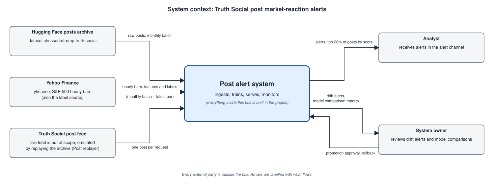
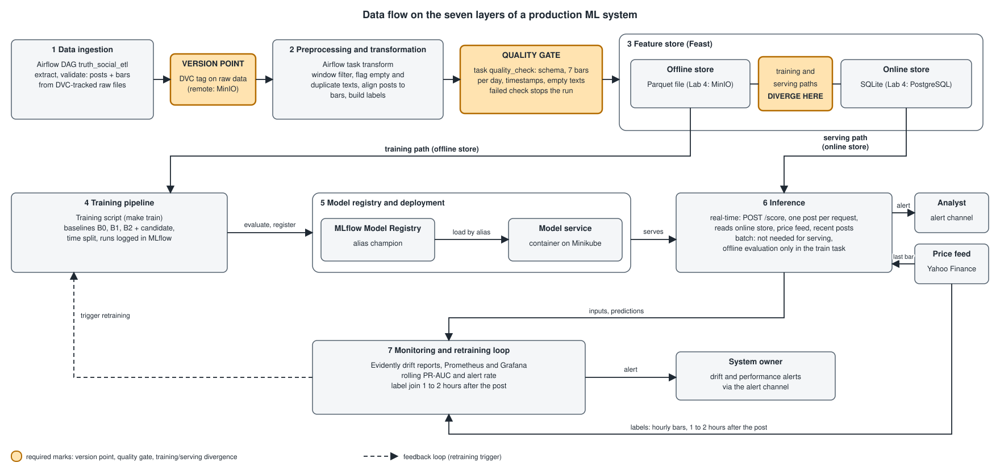
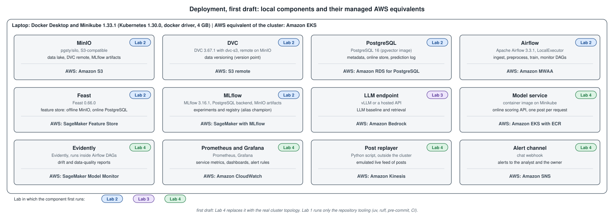

# Design document: Truth Social post market-reaction alerts

Author: Bohdan Kolisnyk · Course: AI290 MLOps · Status: Lab 1 draft

## 1 Overview

Posts by Donald Trump on Truth Social are sometimes followed by sharp moves in US equities. This project builds a system that receives each new post as it is published, scores it, and estimates the probability that the S&P 500 makes an abnormal move, one larger than usual for that time of day, between the start of the hourly bar that contains the post and the end of the next hourly bar, during the regular US trading session. The highest-scoring posts, about one in five, are sent to a market analyst as alerts. The desired outcome is that flagged posts are clearly more likely to be followed by a large move than a typical post, and that the model keeps up with new data and changing market regimes. The system is a predictive alerting tool: it does not place trades and it makes no claim that posts cause market moves.

## 2 Motivation

**Consumer.** A discretionary trader or analyst who watches US equity indices (a US500 CFD, with the S&P 500 as the proxy) and wants to know which posts deserve immediate attention.

**Volume and frequency.** The archive holds 36,924 posts since February 2022. Since December 2023 (the start of the price history the system keeps, section 5.2), about 4,900 posts fall inside the window used by the model (trading days, 09:30–14:30 ET): roughly 8 per trading day, and up to 44 in a single hour. Posts come in bursts: about 84% of in-window posts share an hour with another post.

**Why a system and not a notebook.** Posts arrive one at a time and at any hour, and each must be scored within about a minute, before the market reaction is over. The data is non-stationary: topics (for example tariffs in 2025), posting behaviour and market volatility all change. The true outcome is known one to two hours after each post, so the model can be monitored against real labels and retrained regularly. A one-off notebook cannot do any of that.

**Cost of errors.** A false alarm wastes the analyst's attention and trains them to ignore alerts. A missed alert means a missed move. No money moves automatically, so both errors are bounded.

## 3 Success metrics

Reference numbers in this section come from a prototype of the label in section 5.1 (k = 1.5), computed on the hourly price series of section 5.2; Lab 2 recomputes them in the pipeline. The base rate of abnormal moves is 14.5% in the training period, 16.0% in validation and 13.6% in the 2026 hold-out. For comparison, 14.5% of all two-bar windows in the same period are abnormal by the same rule, with or without a post, so posts as a group are not followed by more abnormal moves than an average window. Any value of the system must come from telling posts apart by their text and context.

The operating point is an alert rate: the top 20% of scored posts by `p_abnormal` become alerts, which is 1.2 to 1.8 alerts per trading day depending on posting volume. The rate of 20% is above the base rate of every period, so a perfect model could catch all abnormal moves at this rate, while the load stays at one or two alerts per day. Random alerting at the same rate catches about 20% of abnormal moves, with precision equal to the base rate.

| Layer | Metric | Target |
|---|---|---|
| Business / decision | Coverage of big moves: share of abnormal-move posts that receive an alert at the 20% alert rate | At least 40%, twice random alerting (assumption; revised after the Lab 2 baselines) |
| Business / decision | Analyst load | One or two alerts per trading day on average, at most 20% of scored posts (assumption about one analyst's capacity) |
| Model | PR-AUC on validation and hold-out (optimization metric; threshold-free) | Above the better of baselines B1 and B2 (section 5.3), by a margin shown with a bootstrap interval. No absolute target: since posts as a group show no excess of abnormal moves, failing to beat the baselines is a possible outcome and would be reported as such |
| Model | Calibration of `p_abnormal` (satisficing) | Reliability curve and Brier score reported; no alert threshold is chosen from an uncalibrated score |
| System | Score latency, p95 | At most 500 ms per post (assumption) |
| System | Freshness | Score available at most 60 s after the post reaches the system (assumption; measured on the replayed stream); training data refreshed monthly |
| System | Availability during the trading session | 99% (assumption for a single local instance) |

The business metrics describe what the analyst gets at the chosen operating point. The model metrics describe ranking quality across all thresholds. PR-AUC is the optimization metric; the alert rate, calibration and latency are satisficing constraints.

## 4 Requirements and constraints

### 4.1 Functional requirements

- **Input (online path):** one post per request: `post_id`, `text`, `created_at` (UTC), `has_media`. The service adds market context itself from the hourly price series: the volatility reference σ for the post's time slot and the return of the last completed hourly bar.
- **Output (JSON):** `in_window` (whether the post falls between 09:30 and 14:30 ET on a trading day), `p_abnormal` (probability), `alert` (true if the post is above the alert threshold), `model_version`, and a `fallback` flag. Posts outside the window return `in_window=false` and no score: the label needs the post's hourly bar and the next one inside the same session, and the model is trained only on in-window posts.
- **Callers:** the post-stream consumer calls the service once per new post (in this project, a replay script). Alerts go to the analyst's channel (assumption: a simple chat bot or dashboard). In Lab 5 an agent calls the same endpoint as a tool.
- **Batch path:** a monthly pipeline ingests the latest posts and price bars, builds labels, retrains and evaluates.

### 4.2 Non-functional requirements

| Category | Requirement |
|---|---|
| Freshness | Online: a score at most 60 s after a post arrives (assumption). Batch: posts and price bars refreshed monthly. Labels are available one to two hours after each post. |
| Latency and throughput | p95 at most 500 ms per post. The service receives every post, in the window or not; the peak measured on the archive is 67 posts in one hour, about one per minute, so a single instance is enough. |
| Availability and fallback | 99% during the trading session (assumption). If the model or the price feed is unavailable, return the keyword-rule baseline score (B1) with `fallback=true`. |
| Reproducibility | Every run is tied to a git commit, a data version (DVC, covering both the posts and the price bars) and the pinned environment (`uv.lock`). One command rebuilds the pipeline. |
| Adaptability | New monthly batches enter through a scheduled pipeline. A new model replaces the current one only after beating it on the latest period and being approved by a person (alias `champion` in the registry). |
| Observability without ground truth | Monitor input drift (text length, time slot, σ, text features), prediction drift (alert rate) and data quality (missing post fields, timestamps, and bar completeness: 7 bars on a full trading day, fewer only on scheduled half-days). Real labels arrive one to two hours later, so rolling performance is monitored too. |
| Cost and resources | Everything runs locally on a laptop (Minikube with 4 GB). Cloud cost is only estimated in section 6.7. |

### 4.3 Scope

**In scope:** Truth Social posts from the archive, replayed in time order as a stream for online scoring; the S&P 500 index on hourly bars as the single target; posts published on trading days between 09:30 and 14:30 ET; binary "abnormal move" prediction; monthly batch ingestion and retraining; monitoring.

**Out of scope:** live collection from Truth Social (terms of service; the stream is emulated by replaying the archive), order execution or any trading strategy, other instruments or assets, direction (up or down) prediction, posts outside the window (outside the regular session this is about 70% of the posts that carry a market-period flag; the index has no price outside the session), other sources such as the Twitter archive (a possible later extension), and causal claims about the effect of posts on the market (the system only predicts).

## 5 Methodology

### 5.1 Problem statement

Binary classification. Let `c` be the hourly bar (bars start at 09:30, 10:30, … ET) that contains the post, and `r = log(close(c+1) / open(c))` the index return from the start of that bar to the end of the next one. Then `y = 1` if `|r| > k * sigma`, where `sigma` is the standard deviation of the same two-bar return, starting at the same time of day, over the previous 20 trading days. `sigma` uses only past data and adjusts for the intraday pattern (the first bar after the open is the most volatile).

The window of `r` starts up to 60 minutes before the post and ends 60 to 120 minutes after it. Hourly bars give no finer timing (section 5.2); the part before the post is a known source of noise and of reverse timing (see "Scope of the claim").

`k` is a design choice, not a derived quantity. The starting value is k = 1.5, fixed for statistical power: with k = 2 the validation set contains only 33 abnormal examples, against 98 with k = 1.5 (section 5.4). Results are also reported for k = 1 and k = 2 as a sensitivity check.

**Rejected framing: predicting the direction or the signed return.** In the data, the signed return `r` is centred at zero (mean about 1 bp, standard deviation about 38 bp), so the direction is close to a coin flip. The magnitude of a move matters for risk and is a more learnable target.

**Scope of the claim.** The model predicts association, not causation: it estimates how likely an abnormal move is around a post, given the text and market context. It does not show that the post caused the move. Posts are often reactions to news that moves the market anyway (confounding), and the label window starts before the post, so part of a move can come first (reverse timing). Answering the causal question needs causal inference methods (for example an event study against matched control windows, difference-in-differences, or synthetic control). The prototype already shows why this matters: the share of abnormal windows after posts (14.4%) is the same as across all windows (14.5%). This is out of scope for the project (section 4.3) and appears as a risk (6.9) and a rejected alternative (7.1).

### 5.2 Data

**Sources.**

1. **Posts.** Hugging Face dataset `chrissoria/trump-truth-social` (licence CC-BY-NC-4.0, so non-commercial use only, which fits coursework). 36,924 posts, 2022-02-14 to 2026-10-16, 187 columns: post text and timestamps, price snapshots for 18 tickers, GDELT news indicators, and LLM-assigned post categories from 2024-11-05. Only the post fields are used; the price columns are not (see the known issues).
2. **Prices.** Hourly bars (open, high, low, close) of the S&P 500 index (^GSPC) from Yahoo Finance via the yfinance library. The first download covers 2023-11-17 to 2026-10-16: 5,082 bars on 730 trading days.

**Arrival pattern.** There are two paths.

- **Online:** posts arrive one at a time, at any hour, and each post is scored on arrival. In this project the live feed is emulated by a replay script that sends archive posts to the service in time order (live collection is out of scope).
- **Batch:** the post archive is refreshed by its maintainer (daily, according to its documentation), and new price bars are appended from the source. The training pipeline ingests both as monthly batches.

**Usable rows.** Posts on trading days between 09:30 and 14:30 ET, so that the post's bar and the next one are full bars of the same session (the session runs 09:30–16:00 ET and its last bar, 15:30–16:00, lasts half an hour). Holidays have no bars, and on half-days the window shrinks automatically because both bars must exist. The label needs 20 earlier trading days for σ, so the first labelled post is from 2023-12-18. Result: **4,877 labelled posts** up to 2026-10-16, on 621 trading days, about 7.9 per day. 3,741 of them have non-empty text.

**Labels and delay.** The label is known at the close of bar c+1, which is one to two hours after the post.

**Training time versus serving time.**

| Field | Training | Serving |
|---|---|---|
| Post text, timestamp, media flag | archive | request |
| Return of the last completed hourly bar | hourly bars | price feed at request time (in replay: the hourly bars) |
| σ for the post's time slot | hourly bars | online feature store, refreshed daily |
| Bars c and c+1 | used only to build the label | not available at the time of the post |
| Dataset price columns `sp500_*` | not used | not used |
| GDELT indicators, LLM categories | archive | not used (see section 5.3) |

**Checklist justification.**

- **Time axis.** Every post has a timestamp to the second and every bar has a start time, so monthly batches can be ingested in Lab 2 and a shift can be injected in Lab 4.
- **Enough history to hold out.** About two years and ten months of hourly bars (2023-11-17 to 2026-10-16). The hold-out is 2026 (see section 5.4).
- **Labels with known delay.** One to two hours after the post. This makes monitoring close to real time: rolling performance can be computed with a lag of two hours.
- **Text surface.** The posts themselves are the text. The Lab 3 retrieval corpus is the post archive together with each post's measured market reaction.

**Known data issues and the plan for each.**

- **The dataset's own prices are not aligned with the post time.** On 4,652 posts covered by both sources, `sp500_at_post` equals the close of the hourly bar that contains the post in 99.6% of cases, that is, a price up to 60 minutes after the post. `sp500_1hr_after` equals the close of the second bar after it in 89% of cases, 2 to 3 hours after the post and on the next day for afternoon posts. A label built on these columns would measure the wrong window. Plan: do not use them; all prices come from source 2.
- **Mixed granularity in the dataset.** Its intraday prices are hourly for most rows but 5-minute, 1-minute or unflagged for recent ones (the source keeps fine bars only for days or weeks). Plan: resolved by source 2, which has one granularity (hourly bars starting at :30 ET) for the whole period. Bar completeness per day is monitored as a data-quality check.
- **Limited retention of hourly bars.** The source provides hourly bars only for about the last two years, so bars older than that cannot be downloaded again. Plan: the downloaded file is the system's own record of prices; it is versioned with DVC and extended every month by the ingestion pipeline. This is also why the labelled history starts in December 2023.
- **Coarse timing.** With hourly bars the label window starts up to 60 minutes before the post. Plan: accept it, state it in the label definition (section 5.1), and list reverse timing as a risk (6.9).
- **Empty and duplicate texts.** 23.3% of in-window posts have no text (media or reposts) and 118 texts are duplicates. Plan: drop empty texts and deduplicate in preprocessing.
- **Bursts.** About 84% of in-window posts share an hour with another post, so observations are not independent. Plan: time-based split and grouping by hour.
- **Dataset flag for market hours.** `during_market_hours` uses 09:30–16:00 ET, which is wider than our window, and it is missing for posts after 2026-03-23. Plan: derive the window ourselves from the UTC timestamp (America/New_York) and the trading days in source 2.

### 5.3 Techniques

**Baselines, in order.**

1. **B0: constant prior.** Every post gets the same score (the training base rate).
2. **B1: keyword rule.** The score is the number of hits from a fixed list of market-relevant terms (tariff, China, Fed, and similar). B1 is also the fallback of the service (section 4.2).
3. **B2: context-only model.** A simple model on the time slot, σ and the return of the last completed bar, with no text. It shows whether the text adds anything at all.

**Candidate.** Text features (TF-IDF or sentence embeddings) plus the context features below, with logistic regression or a gradient-boosted model. Lab 3 adds a zero-shot LLM baseline for comparison.

**Features and their serving-time source.**

| Feature | Serving-time source |
|---|---|
| Text features (TF-IDF or embedding) | request body |
| Text length, media flag, link count, share of capital letters | request body |
| Time slot (hourly bar), weekday, minutes since the open | derived from the request timestamp |
| σ for the post's time slot | feature store, online side (refreshed daily) |
| Return of the last completed hourly bar | price feed at request time (in replay: the hourly bars) |
| Number of posts in the previous 60 minutes | recent posts table (database) |

**Excluded on purpose.** The bars c and c+1 (they define the label). All `sp500_*` columns of the dataset (not aligned with the post time, section 5.2). GDELT indicators (timing unclear). LLM categories (available only from 2024-11-05, about 20% coverage).

**Training-serving skew example.** The number of posts in the previous 60 minutes and the return of the last completed bar must be computed as of the post timestamp. A careless join on the hour in training would count posts published later in the same hour, or use the bar that contains the post, which the serving path cannot see. Training therefore uses point-in-time joins for these features.

### 5.4 Experimentation and validation

**Split by time, never random.** A random split would mix periods and let the model see the market regime and near-duplicate posts from the future.

| Set | Period | Labelled posts | Abnormal (k = 1.5) |
|---|---|---|---|
| Train | 2023-12-18 to 2025-06-30 | 3,056 | 442 (14.5%) |
| Validation | 2025-07-01 to 2025-12-31 | 613 | 98 (16.0%) |
| Test (hold-out) | 2026-01-05 to 2026-10-16 | 1,208 | 164 (13.6%) |

These are prototype counts; Lab 2 recomputes them in the pipeline. Split boundaries fall between calendar half-years, so posts of the same hour never straddle a boundary. Inside the training period, use expanding-window cross-validation by month. The validation set has 98 positive examples, so confidence intervals are wide; results are reported with a bootstrap by hour.

**Alert threshold.** Set on the validation period so that 20% of posts are flagged, then kept fixed on the hold-out. The alert rate on new data is monitored (section 4.2).

**Offline metrics.** PR-AUC (optimization). Coverage and precision at the 20% alert rate, and calibration (satisficing).

**Comparing a new model with the current one.** Both are evaluated on the most recent period. A challenger is promoted only if it improves PR-AUC and coverage at the 20% alert rate, with a bootstrap confidence interval that resamples by hour so that clusters are not split. Promotion is approved by a person (section 5.5).

### 5.5 Human in the loop

All roles are played by one person, but they are kept separate in the design.

- **Analyst:** receives alerts and can mark each as useful or not (optional feedback).
- **System owner:** reviews every drift alert (Evidently report and the dashboard) by the end of the next trading day, and approves or rejects each model promotion after reading the comparison report.
- **Override:** the owner can roll the `champion` alias back to the previous version and set the alert threshold by configuration. The analyst can mute the alert channel.

## 6 Implementation

### 6.1 High-level design

The three diagrams below use the same component names as section 6.2.

**System context.**

**Data flow on the seven layers.** The version point (DVC tag on the raw data), the quality gate (end of preprocessing, before the feature store) and the point where the training path and the serving path diverge (offline and online sides of Feast) are marked in orange.

**Deployment, first draft.** Every component carries the lab in which it first runs; Lab 4 replaces this diagram with the real cluster topology.

### 6.2 Infra

The local stack follows the course reference stack with its pinned versions. AWS is used as the single reference cloud for the managed equivalents (assumption: one provider keeps the cost estimate in section 6.7 simple; the GCP and Azure equivalents are listed in the course reference table).

| Component | Local reference | Role | First runs in | Managed equivalent (AWS) |
|---|---|---|---|---|
| MinIO | pgsty/silo, S3-compatible | object storage: raw, clean and feature files, DVC remote, MLflow artifacts | Lab 2 | Amazon S3 |
| DVC | DVC 3.67.1 with dvc-s3, remote on MinIO | data versioning of posts and price bars (version point) | Lab 2 | S3 remote |
| PostgreSQL | PostgreSQL 16 (pgvector image) | MLflow and Airflow metadata, Feast online store, recent posts, prediction log; pgvector index from Lab 3 | Lab 2 | Amazon RDS for PostgreSQL |
| Airflow | Apache Airflow 3.3.1, LocalExecutor | orchestrator: ingest, preprocess, train and monitoring DAGs | Lab 2 | Amazon MWAA |
| Feast | Feast 0.66.0 | feature store: offline side on MinIO, online side on PostgreSQL (optional extra point in Lab 2) | Lab 2 | SageMaker Feature Store |
| MLflow | MLflow 3.16.1, PostgreSQL backend, MinIO artifacts | experiment tracking and model registry (alias champion) | Lab 2 | SageMaker with MLflow |
| LLM endpoint | vLLM or a hosted API | LLM baseline and retrieval-augmented answers | Lab 3 | Amazon Bedrock |
| Model service | container image on Minikube | online scoring API, one post per request | Lab 4 | Amazon EKS with ECR |
| Evidently | Evidently, runs inside Airflow DAGs | drift and data-quality reports | Lab 4 | SageMaker Model Monitor |
| Prometheus and Grafana | Prometheus, Grafana | service metrics, dashboards and alert rules | Lab 4 | Amazon CloudWatch |
| Post replayer | Python script, outside the cluster | emulated live feed: sends archive posts to the model service in time order | Lab 4 | Amazon Kinesis |
| Alert channel | chat webhook | delivers alerts to the analyst and drift alerts to the system owner | Lab 4 | Amazon SNS |

The cluster itself is Minikube 1.33.1 (Kubernetes 1.30.0, docker driver, 4 GB); its AWS equivalent is Amazon EKS.

**External services, not run by the project.** Hugging Face hosts the posts archive. Yahoo Finance provides the hourly price bars and the price feed (through the yfinance library).

**Repository tooling, from Lab 1.** uv (pinned environment), ruff (linter), pre-commit, and GitHub Actions (lint on every push).

### 6.3 Performance

**Throughput.** The service receives every post, inside the window or not. The peak measured on the archive is 67 posts in one hour, about one per minute; the average is about 20 posts per day. A single instance of the model service is enough. Monthly training runs on about 5,000 labelled posts and fits on a laptop CPU in minutes (assumption, measured in Lab 2).

**Latency budget per request, p95 at most 500 ms (assumption).**

| Step | Budget |
|---|---|
| Read σ from the online store and count recent posts in PostgreSQL | 50 ms |
| Last completed bar from the price feed (cached: it changes once an hour) | 50 ms with cache, up to 300 ms on a cache miss |
| Text features and model inference | 50 ms |
| Network, serialisation, logging | the rest |

**Batch or online.** Online for scoring: posts arrive at irregular times and the value of an alert decays within the 1 to 2 hour label window, so an hourly batch would deliver some alerts up to 60 minutes late. Batch for everything that does not need to be immediate: ingestion, labels, training and drift reports run as scheduled Airflow DAGs, because labels arrive 1 to 2 hours after the post and the model is retrained monthly. The LLM component of Lab 3 is not on the 500 ms scoring path.

### 6.4 Security

- **Secrets.** MinIO keys, the PostgreSQL password, the chat webhook URL and any LLM API key live in a local `.env` file that git ignores, and in Kubernetes Secrets on Minikube from Lab 4. Nothing secret is committed; the Lab 1 CI needs no secrets. AWS equivalent: AWS Secrets Manager.
- **Who may call the service.** The model service is reachable only inside the cluster or through a local port-forward. Its callers are the post replayer and, from Lab 5, the agent. Airflow, MLflow and Grafana web interfaces listen on localhost only and require a password.
- **Supply chain.** The Python environment is pinned by `uv.lock`, and container images use the pinned versions of the reference stack.

### 6.5 Data privacy

- **What personal data the dataset contains.** Public posts by a public figure, with engagement counts and media links. Posts can mention other people by name, including private individuals. No data about the analyst or other users is collected beyond the alert channel address.
- **What is kept and for how long.** Post text, timestamps and the price bars are kept for the duration of the course, versioned with DVC so that every run can be reproduced. Media files are not downloaded, only their links are stored. The prediction log is kept for 90 days (assumption).
- **Deleted posts.** If a post disappears from the upstream archive, it disappears from the next monthly version; older DVC versions still contain it (accepted for coursework, stated here).
- **Licences and terms.** The posts dataset is CC-BY-NC-4.0 (non-commercial use with attribution, given in the README). Yahoo Finance data is used for personal, non-commercial study. Neither the posts nor the bars are published: the DVC remote is the local MinIO, not a public bucket, and the public repository holds only code and documents.

### 6.6 Monitoring and alarms

**What is logged.** For every request: `post_id`, timestamp, the feature values, `p_abnormal`, `alert`, `model_version` and latency, in the prediction log in PostgreSQL. When bar c+1 closes, the label is joined to the logged prediction.

| What | Metric | Threshold (first draft) | Who receives it |
|---|---|---|---|
| Service health | error rate, p95 latency (Prometheus) | error rate above 1% or p95 above 500 ms for 10 minutes | system owner |
| Data freshness | age of the newest bar and of the newest post in the store | newest bar older than one trading hour during the session; newest post older than 2 days | system owner |
| Data quality | quality gate: schema, bars per full trading day, timestamps, share of empty texts | any check fails (the run stops); share of empty texts above 40% (23% in the archive) | system owner |
| Input drift | Evidently drift score per feature (text length, time slot, σ, keyword share) against the training period | PSI above 0.2 on any monitored feature | system owner |
| Prediction drift | alert rate over the last 5 trading days | outside 10% to 30% (target 20%) | system owner |
| Model performance | rolling PR-AUC over the last 20 trading days, after the label join | below the validation PR-AUC of baseline B2 | system owner; starts the retraining DAG (stretch goal of Lab 4) |
| Alerts for the analyst | `p_abnormal` above the threshold of section 5.4 | top 20% of posts | analyst |

The data freshness alert watches the data itself, not the job status, so a pipeline that succeeds while reading the same stale partition is still caught. Lab 4 turns this table into Evidently reports, Prometheus rules and Grafana dashboards.

### 6.7 Cost

Estimated with the AWS Pricing Calculator: region US East (N. Virginia), on-demand prices, about 730 hours a month, no free tier assumed except where the calculator applies it. The saved estimate with every line and its settings: [AWS Pricing Calculator estimate](https://calculator.aws/#/estimate?id=ebf0fe054d45012cab3c99a7a167934bae940e6d) (public link, valid until October 2027).

| AWS service | Sizing assumption | USD per month |
|---|---|---|
| Amazon EKS | 1 cluster (control plane) | 73.00 |
| Amazon EC2 (EKS nodes) | 2 × t3.medium, Linux, 20 GB gp3 each | 63.94 |
| Amazon MWAA | small environment, always on: 1 worker, 2 web servers, 2 schedulers, 1 GB | 357.80 |
| Amazon RDS for PostgreSQL | db.t4g.small, Single-AZ, 20 GB gp3, no RDS Proxy | 25.66 |
| Amazon SageMaker: MLflow | 1 small tracking server, always on, 10 GB | 439.05 |
| Amazon SageMaker: Feature Store | 1 GB, 50,000 writes and 10,000 reads a month | 0.51 |
| Amazon SageMaker: Processing (Model Monitor) | 30 jobs a month, 30 minutes each, ml.m5.large | 1.73 |
| Amazon S3 | 10 GB Standard, 100,000 PUT and 500,000 GET requests | 0.93 |
| Amazon Kinesis Data Streams | 1 provisioned shard, 1 record per second, 1-day retention | 10.99 |
| Amazon CloudWatch | 20 custom metrics (1 dashboard and 5 alarms fall within the free tier) | 6.00 |
| Amazon ECR | 5 GB of images | 0.50 |
| Amazon Bedrock | Llama 3 70B, about 1,800 requests a month (900 input and 250 output tokens each) | 5.87 |
| Amazon SNS | under 1,000 notifications (free tier; not added to the saved estimate) | 0.00 |
| **Total** | | **985.98** (11,831.76 a year) |

Two always-on managed services, MWAA and the MLflow tracking server, make up about 81% of the total. The cheaper variant runs Airflow and MLflow on the EKS nodes instead (for example 2 × t3.large), at roughly 250 USD per month (a rough estimate, not in the saved calculator estimate), at the cost of operating them ourselves. If the estimate turns out ten times too low, the most likely wrong assumption is the size or running hours of these two services; the first requirement to relax is availability outside the trading session (stop them overnight and at weekends).

### 6.8 Integration points

| Party | Owner | Contract |
|---|---|---|
| Posts archive (upstream) | dataset maintainer on Hugging Face (Chris Soria, UC Berkeley; source: the CNN/Stiles Truth Social archive) | Parquet with at least `post_id`, `datetime` (UTC, ISO 8601), `text`, `has_media`; refreshed daily; no service level (assumption). The schema is checked at the quality gate; if the archive is late, the last good version is used and the freshness alert fires. |
| Price bars and price feed (upstream) | Yahoo Finance, through the unofficial yfinance library | Hourly open, high, low, close of ^GSPC, bar start at :30 ET, about two years of retention, no service level. The project keeps its own versioned copy of the bars. |
| Analyst (downstream) | the analyst | An alert with `post_id`, post link, time, `p_abnormal` and `model_version`, at most 60 s after the post arrives (assumption), for about 20% of in-window posts. The full response is the JSON of section 4.1. |
| Agent (downstream, Lab 5) | the project | The same `/score` endpoint and response, plus a retrieval tool over the post archive; the endpoint is versioned (`v1`) so that the agent does not break when the model changes. |

### 6.9 Risks and uncertainties

| Risk | Mitigation |
|---|---|
| No predictive signal: posts as a group show no excess of abnormal moves (14.4% against 14.5% for all windows) | Baselines first; report a negative result honestly. The labs grade the system, not the model. |
| Confounding and reverse timing: the label window starts up to 60 minutes before the post | Predictive claim only (section 5.1); compare posts early and late within their bar; a causal study stays a possible extension (7.1). |
| Selection: only posts between 09:30 and 14:30 ET are scored, while many market-relevant posts come in the evening or at weekends | Stated in scope (4.3); extension: an overnight-gap label on futures or CFD prices. |
| The upstream archive changes its schema or stops updating | Schema check at the quality gate, freshness alert, last good DVC version stays usable. |
| yfinance is unofficial: it can break, change or be blocked, and keeps hourly bars for only two years | Own versioned copy of the bars; an alternative price source is named in 7.1. |
| Coarse timing of hourly bars adds label noise | Documented in 5.1 and 5.2; sensitivity check over k. |
| Few positive examples (98 in validation) | k = 1.5, bootstrap intervals by hour, no heavy tuning on validation. |
| Leakage through features computed after the post or through near-duplicate posts | Time split, point-in-time joins in Feast, deduplication in preprocessing. |
| Concept drift: new topics and market regimes | Drift monitoring (6.6) and monthly retraining with human approval. |
| The laptop cannot run the whole stack at once (Minikube has 4 GB) | Lab 2 services run in Docker Compose; only the serving side moves to Minikube in Lab 4; the LLM runs outside the cluster. |
| Licence and terms: CC-BY-NC for the posts, Yahoo Finance terms for prices | Non-commercial coursework only; data is never published in the public repository. |

## 7 Appendix

### 7.1 Alternatives

| Alternative | Pros | Cons | Decision |
|---|---|---|---|
| Causal framing: event study against matched control windows, difference-in-differences, synthetic control | Answers whether posts move the market | Needs identification assumptions and control windows; it is a research study, not an alerting system | Rejected for the project; possible extension |
| Use the dataset's own price columns instead of a separate price source | No second source; history from 2023-05; 18 tickers | Prices are not aligned with the post time (section 5.2) and their granularity changes over time | Rejected |
| Predict the direction or the signed return | A trading signal if it worked | The signed return is centred at zero (section 5.1) | Rejected |
| Streaming platform (Kafka, Spark Streaming) for the post feed | Real streaming semantics | Far too heavy for about one post per minute; discouraged for this course | Rejected; a replayer calling an HTTP endpoint is enough |
| Hourly batch scoring instead of online scoring | Simpler serving | Alerts up to 60 minutes late, after much of the reaction window | Rejected |
| 1-minute SPX/USD quotes from histdata.com as the price source | Finer timing, nearly 24-hour coverage close to a CFD | The ready-made archive we checked ends in 2024; a CFD quote, not the index | Kept as an extension |

### 7.2 Experiment results

Placeholder: filled in Lab 2.

### 7.3 Performance benchmarks

Placeholder: filled in Lab 4.

### 7.4 Milestones

- **Lab 2:** monthly Airflow ingestion of posts and hourly bars with data intervals, DVC on MinIO, the quality gate, labels, baselines B0 to B2 and the candidate tracked in MLflow with a `champion` alias, and Feast for the offline and online features.
- **Lab 3:** a zero-shot LLM baseline for the same label and retrieval over the post archive with each post's measured reaction (pgvector), evaluated on at least 30 questions and logged in MLflow.
- **Lab 4:** the model service on Minikube fed by the post replayer, Evidently, Prometheus and Grafana monitoring, and an injected drift that reaches the system owner through the alert channel.
- **Lab 5:** an agent with a retrieval tool (similar past posts and their reactions) and a prediction tool (the `/score` endpoint), traced and evaluated on ten tasks.